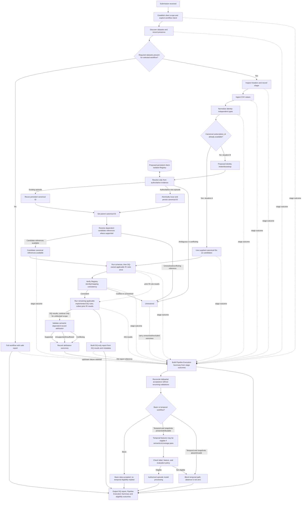

# MVP Architecture and Technical Design

> **Historical design record.** This document preserves the Phase 02 assessment and its implementation observations at the time of review. For governing requirements, see the [approved Customer Data Contract](../04_data/customer_data_contract.md) and [ADR-010](adr_episode_identity_and_identifier_management.md).

**Document ID:** NCI-MVP-ARCH-001
**Version:** 0.1
**Status:** Draft for technical and product review
**Project:** Nowa Customer Intelligence
**Scope:** Phase 2.4.4.8 — MVP Architecture and Technical Design
**Assessment date:** 2026-11-15

> This is a proposed architecture. It does not authorize implementation, approve a revised Customer Data Contract, assign a contract version, or select an unapproved storage technology.

## 1. Executive Summary

The proposed MVP is a modular, initially local-first application pipeline that accepts controlled client CSV submissions, validates them through the existing ingestion, normalization, Pandera, and Data Quality components, resolves episode identity through a new persistent client-isolated Registry, and passes only eligible episode records to downstream feature/model components.

Existing modules provide useful layers but do not yet form a complete product pipeline. Header inspection, CSV ingestion, type normalization, five schemas, immutable DQ models, and RI/TC rule functions exist. The loader still requires snapshots unconditionally; a DQ coordinator/report builder, workflow orchestration, persistent identity Registry, dependent-record attribution, acceptance/eligibility controls, model pipeline, and operational interfaces are absent or outside this data foundation.

The MVP Registry recommendation is a deliberately limited persistent component implementing ADR-010 and PD-001–PD-004 invariants: client isolation, authoritative issuance, stable reuse, conflict/unresolved visibility, and traceable corrections/history. Advanced review UI and generalized automated workflows can follow, but these invariants cannot be deferred. Basic ingestion and temporal modelling must be explicit workflows under PD-006. Missing snapshots are not zero activity and successful ingestion is not modelling eligibility.

The design enables staged delivery: validate datasets first; establish persistent identity and transparent partial acceptance; process attributable episode data; then add training/prediction only after label and evaluation decisions are ready. Source identifier exchange, episode evidence, child attribution, workflow API, storage technology, empty-file policy, retention, and client compatibility remain decisions. **This proposal is sufficiently detailed to guide a separate implementation plan, but implementation authorization should wait for the design decisions and acceptance criteria identified here.**

## 2. Architecture Scope and Design Principles

### 2.1 MVP objectives

- Accept controlled client submissions against the currently approved contract until a revised contract is separately approved.
- Validate input structure, types, fields, and implemented cross-dataset rules without silently modifying identifiers or dropping data.
- Provide persistent, client-isolated canonical episode identity for evidence-supported records.
- Preserve unresolved and excluded records as explicit outcomes; do not let them enter identity-dependent processing.
- Separate basic ingestion from temporal-modelling intent.
- Keep dataset acceptance, identity resolution, attribution, feature eligibility, training eligibility, and prediction eligibility distinct.
- Deliver incrementally without requiring every future lifecycle or migration capability before the first controlled use.

### 2.2 Derived requirements and recommendations

**Approved requirements:** episode-level prediction entity (ADR-009 and EP-DEC-002); Nowa-owned canonical identity and persistent client-isolated Registry (ADR-010); issuance/reuse only on authoritative evidence (PD-002); unresolved handling (PD-003); history-preserving submission/correction behavior (PD-004); partial migration principles (PD-005); snapshot availability policy (PD-006); and compatibility/version review (PD-007).

**Architectural recommendations:** explicit application-service orchestration; immutable per-run contexts; transactional Registry operations; staged persistence of submissions/findings; local-first modular deployment; and no external infrastructure until operational need is demonstrated. These recommendations require technical/product review and are not approvals.

### 2.3 Non-functional requirements

- **Isolation:** no cross-client access to source rows, registry mappings, identity evidence, or reports.
- **Integrity:** canonical identity is persistent; updates cannot silently overwrite history; concurrent issuance cannot create competing IDs for one recognized episode.
- **Traceability:** submission, execution, decisions, and mapping history are linked by internal references without exposing raw sensitive values in ordinary logs.
- **Privacy:** minimize persisted data; pseudonymous client scope; report/log output avoids direct identifiers and raw rows; retention/deletion policy requires governance approval.
- **Reliability:** fatal file/persistence errors are distinct from record-level exclusion; interrupted runs are recoverable and not misrepresented as complete.
- **Maintainability:** preserve the src-based package and clear separation of ingestion, normalization, schemas, DQ rules, orchestration, Registry, and modeling.
- **Local-first:** development and the first controlled deployment may use a single application process and durable local deployment storage, subject to access control, backup, and operational review. This is a recommendation, not a mandated production topology.
- **Extensibility:** storage and application interfaces should allow later migration, but no generic plugin or distributed service framework is justified yet.

## 3. Current Architecture and Implementation Assessment

The following distinguishes implemented code from proposed integration. “Exists” does not mean the end-to-end capability exists.

| Component | Existing implementation | Current capability | Limitation | Proposed architectural role |
|---|---|---|---|---|
| Header inspection | `data/ingestion/header_inspection.py`; unit tests | Reads UTF-8/BOM CSV header; validates expected required/optional columns, duplicates, whitespace, delimiter and unexpected columns. | Current allowlist requires `subscription_id` in relevant files; cannot intake an alternate pre-canonical identity representation that has not been designed/approved. | Structural validation stage before identity resolution, using an approved input representation. |
| CSV ingestion | `data/ingestion/csv_ingestion.py`; unit/integration tests | Preserves CSV values as strings, validates row widths, loads datasets. Usage/invoices optional. | Customers, subscriptions, and snapshots are unconditionally required; no submission record/transaction. | Intake parser behind workflow-aware discovery. |
| Type normalization | `data/preprocessing/type_normalization.py`; unit tests | Explicit string, numeric, Int64, boolean and UTC datetime conversions; returns normalized frames. | No schema, identity, attribution, or client workflow orchestration. | Loss-aware normalization stage. |
| Pandera schemas | Five modules under `data/schemas/`; extensive unit tests | Strict field/type/nullability/key/value validation, `coerce=False`, `add_missing_columns=True`. | Current schemas require canonical `subscription_id`; cannot validate a pre-canonical representation as-is, and cannot establish identity provenance or correct episode attribution. | Canonical-ID-dependent schema gate after identity bootstrap where needed; independent checks may be earlier only if separately implemented. |
| Referential integrity | `data/validation/referential_integrity.py`; unit tests | RI-001–RI-004 findings, including optional usage/invoice applicability. | Requires canonical identifier columns; checks key existence only, not correct episode mapping; currently requires snapshots in its input mapping. | Run after required canonical IDs are available and applicable schemas pass. |
| Temporal consistency | `data/validation/temporal_consistency.py`; unit tests | TC-001/TC-002 compare present end/cancellation dates to start date. | No snapshot/usage temporal attribution or workflow cutoff logic. | DQ temporal rule group for implemented rules. |
| DQ models | `data/validation/models.py`; unit tests | Immutable finding, summary, report models; severity/status/result and safe metadata validation. | Models do not themselves coordinate validation or build execution outcomes. | Shared result contracts for DQ services. |
| DQ coordinator/reporting | No complete coordinator/report builder implemented. | None beyond rule functions/models. | No integrated presence/results/summary/blocking/report creation. | New application service and report builder, authorized separately. |
| Workflow orchestration | No end-to-end workflow orchestrator. | Components callable separately. | No run context, stage sequencing, basic/temporal mode, transaction boundary, or partial acceptance. | New orchestrator coordinates existing and proposed services. |
| Episode Identity Registry | Not implemented. | No persistent canonical issuance, reuse, client isolation, mapping or audit. | Core approved architecture gap. | New persistence-backed identity service/repository. |
| Dependent-record attribution | Not implemented. | RI checks existence, not attribution. | Snapshot/usage/invoice evidence and policies unresolved. | New semantic attribution gate after technical validation; unresolved records excluded. |
| Model eligibility controls | Not implemented in inspected data pipeline. | No explicit feature/training/prediction gate. | Data acceptance cannot currently be separated operationally from model readiness. | New eligibility coordinator after identity, attribution, DQ, and policy checks. |
| Model/reporting application | Configuration includes optional ML/dashboard/API extras; no integrated MVP pipeline was evidenced in inspected components. | Dependencies available as optional extras; not proof of product implementation. | Model, UI, deployment, and operational paths require separate design. | Later feature/model/output and reporting layers. |

## 4. Proposed High-Level Architecture

### 4.1 Layers and responsibilities

1. **Client data interface:** receives contract-named files and agreed submission context; it does not infer identity from file arrival.
2. **File intake/submission management:** records a submission event and scoped execution metadata; keeps originals or secure references according to an approved retention policy.
3. **Structural validation:** dataset discovery, workflow-aware presence checks, header inspection, encoding and row-width checks.
4. **Normalization:** explicit conversion from source CSV strings to expected types; errors are contextual and do not rewrite IDs.
5. **Identity input classification:** determine whether an established canonical ID is already supplied or an approved identity bootstrap path is needed. This is proposed orchestration, not current behavior.
6. **Canonical identity/reference resolution:** treat incoming canonical IDs as candidates. In Situation A, use them for technical checks and verify Registry consistency before acceptance. In Situation B, resolve parent episode identity and establish dependent canonical references where supported before checks that require them. This does not prove semantic attribution.
7. **Schema validation:** run checks independent of canonical identity when safely separable; run current full schemas requiring `subscription_id` only when each relevant canonical reference is available.
8. **Referential integrity:** after schemas pass and canonical references are present, execute the DQ-owned RI rule implementations once; they verify key existence only.
9. **Data Quality assessment:** execute applicable implemented DQ rules once at their defined stage and produce DQ findings/rule results and a DQ-only report from those results and applicable DQ metadata. Canonical-ID-dependent RI rules run once in Stage 7 after schemas pass; this stage carries those RI results forward and runs any other applicable implemented rules. Do not repeat schema/RI checks, duplicate upstream errors, own Registry consistency, or decide submission acceptance.
10. **Semantic attribution validation:** separately assess whether each snapshot, usage row, or invoice is supported as belonging to its referenced episode. Evidence and period semantics remain dataset/client dependent.
11. **Pipeline execution summary:** the overall execution layer consolidates outcomes from each processing stage without rerunning validation or changing stage results; it may reference the DQ report by ID without copying its detailed findings.
12. **Acceptance and eligibility:** use the consolidated execution outcomes to determine full/partial acceptance, unresolved/excluded populations, and feature/training/prediction eligibility. Do not rerun validation.
13. **Feature/model:** prepare episode features and run approved training/prediction only for eligible records.
14. **Reporting/operations and persistence/audit:** present the DQ report and Pipeline Execution Summary as distinct outputs, and preserve submission, Registry, and execution history; detailed interfaces and storage remain open.

### 4.2 High-level diagram

```mermaid
flowchart LR
    Client[Client CSV files and agreed context] --> Intake[Proposed submission intake]
    Intake --> Structural[Existing header inspection and proposed presence orchestration]
    Structural --> Ingest[Existing CSV ingestion where approved header is supported]
    Ingest --> Normalize[Existing type normalization where applicable]
    Normalize --> InputKind{Canonical subscription_id already present?}
    InputKind -->|Yes: situation A| CandidateA[Use supplied canonical IDs as candidates]
    InputKind -->|No: situation B| Bootstrap[Proposed identity intake/bootstrap]
    Bootstrap --> Resolve[Proposed evidence-based resolution]
    Registry[(Proposed persistent client-isolated Registry)] <--> Resolve
    Resolve -->|Existing episode| Reuse[Reuse persisted canonical ID]
    Resolve -->|Authoritative new episode| Issue[Issue and persist canonical ID]
    Resolve -->|Ambiguous or conflicting| Unresolved[Unresolved and excluded path]
    Reuse --> Canonicalize[Set parent canonical ID]
    Issue --> Canonicalize
    Canonicalize --> RefResolve[Proposed dependent canonical reference resolution where supported]
    RefResolve -->|Candidate references available| CandidateB[Candidate canonical references available]
    RefResolve -->|Reference unresolved/conflicting| Unresolved
    CandidateA --> Technical[Existing schemas, then DQ-owned applicable RI rules run once after references are available]
    CandidateB --> Technical
    Technical --> RegistryCheck[Proposed Registry identity/mapping consistency verification]
    RegistryCheck -->|Consistent| DQ[Proposed DQ coordinator runs remaining applicable rules and collects DQ results]
    RegistryCheck -->|Conflict or unresolved| Unresolved
    Technical -. prior RI rule results .-> DQ
    DQ --> Attribution[Proposed semantic attribution validation for unblocked scope]
    DQ --> DQReport[Proposed DQ report builder creates DQ-only report]
    DQReport -. report reference .-> ExecutionSummary[Pipeline Execution Summary in orchestration layer]
    DQ -. DQ rule results .-> ExecutionSummary
    Intake -. stage outcome .-> ExecutionSummary
    Structural -. stage outcome .-> ExecutionSummary
    Ingest -. stage outcome .-> ExecutionSummary
    Normalize -. stage outcome .-> ExecutionSummary
    Attribution --> ExecutionSummary
    CandidateA -. stage outcome .-> ExecutionSummary
    CandidateB -. stage outcome .-> ExecutionSummary
    Technical -. stage outcome .-> ExecutionSummary
    RegistryCheck -. stage outcome .-> ExecutionSummary
    Unresolved -. counted/excluded outcomes .-> ExecutionSummary
    ExecutionSummary --> Acceptance[Proposed acceptance/eligibility coordinator determines acceptance and eligible populations]
    Acceptance -->|Basic workflow| Basic[Basic-ingestion accepted output]
    Acceptance -->|Temporal workflow and snapshots eligible| Temporal[Temporal feature path]
    Acceptance -->|Not eligible| Excluded[Excluded from model processing]
    Basic --> Report[Proposed outputs: DQ report and Pipeline Execution Summary]
    Temporal --> Features[Proposed episode feature preparation]
    Features --> Model[Future authorized training/prediction]
    Model --> Report
    Excluded --> Report
    DQReport --> Report
    ExecutionSummary --> Report
    Intake -. run metadata .-> Persistence[(Proposed submission/execution metadata persistence)]
    DQReport -. DQ report metadata .-> Persistence
    ExecutionSummary -. stage outcomes .-> Persistence
    Resolve -. audit and mapping history .-> Registry
```



The boxes labeled existing are implemented modules; the identity intake/bootstrap, Registry consistency checks, coordinator, Registry, attribution, eligibility, and integrated output are not implemented. Situation B also requires an approved incoming identity representation: current header allowlists expect canonical ID columns, and this diagram does not approve a new CSV field or exchange format. Persistence boxes are conceptual boundaries, not selected database tables or technology.

## 5. End-to-End Data Processing Workflow

The conceptual flow has four stages: **A. preliminary input processing** (intake, dataset presence, structural inspection, parsing, and identity-independent normalization); **B. canonical identity/reference resolution** (confirm candidate IDs or resolve supported parent and dependent references); **C. canonical-ID-dependent technical validation** (current schemas, applicable RI, and implemented temporal checks); and **D. semantic dependent-record attribution validation** after relevant technical validation. A dependent reference-resolution step needed before schema/RI is part of Stage B; it does not perform Stage D or establish final attribution.

| Stage | Input / responsible component | Output | Failure behavior and scope |
|---|---|---|---|
| 1. Submission received/context established | Files and scoped metadata; proposed intake/orchestrator | Submission event and execution context | Invalid client scope blocks the run; a new submission event is not evidence of a new episode. |
| 2. Dataset discovery/presence | Files plus explicit workflow intent; proposed availability policy | Dataset presence map | Missing customers/subscriptions blocks; snapshots are required only for temporal mode; optional absence is informational. |
| 3. Structural inspection | Present files; existing header inspector and CSV parser | Header/row-shape validated raw frames | Invalid encoding/header/row width fails the affected dataset. Situation B requires a future approved intake representation; current allowlists require canonical ID columns. |
| 4. Preliminary type normalization | Raw frames; existing normalizer where applicable | Typed preliminary frames/errors | Invalid values fail affected dataset; IDs are not trimmed or repaired. Identity-independent normalization may occur before identity resolution. |
| 5. Identity input classification | Normalized incoming records/context; proposed orchestrator | Situation A (canonical ID present) or B (bootstrap required) | Unclear identity-input contract blocks that path; do not guess or add a CSV field. |
| 6A. Canonical IDs already present (Situation A) | Candidate canonical IDs supplied in the input | Candidate parent and dependent references available for technical validation | Treat IDs as candidates; their presence alone does not establish authority or Registry consistency. Continue to Stage 7 once required references are available. |
| 6B. Identity/bootstrap and reference resolution (Situation B) | Parent evidence and dependent input; proposed identity/reference resolver and Registry | Evidence-supported candidate canonical parent and dependent references, or unresolved/conflicting outcomes | Reuse or issue parent ID only under ADR-010/PD-002 evidence requirements. Resolve dependent references only where evidence supports them. A candidate reference is not semantic attribution; current CSV path does not implement this workflow. |
| 7. Canonical-ID-dependent schema and RI validation | Candidate canonical references from 6A or 6B; current Pandera schemas and DQ-owned RI rule functions | Schema outcomes and RI rule results | Validate schemas, then execute applicable RI rules once for each eligible frame after its required references are available. Carry RI results forward; Stage 9 must not rerun them. References unresolved at Stage 6 stay outside checks that depend on them. |
| 8. Registry identity/mapping consistency | Candidate IDs and technical validation outcomes; proposed Registry consistency check | Consistent identity/mapping outcome or conflict/unresolved outcome | Verify consistency before identity-dependent acceptance or downstream processing. Registry consistency is separate from schema and RI; RI existence alone does not prove Registry consistency. |
| 9. Data Quality assessment | Schema-valid inputs and Stage 7 RI results after applicable upstream gates; proposed DQ coordinator | DQ findings/rule-level results, DQ blocking decision, and a DQ-only report from DQ results and applicable DQ metadata | Execute applicable implemented rules not already run at Stage 7 (for example, applicable temporal rules), and include prior RI results without rerunning them. Do not rerun schema/RI, duplicate ingestion/normalization/schema errors, own Registry consistency, consolidate all pipeline stages into the DQ report, or decide overall acceptance. Preserve implementation-status/runtime-result distinctions; proposed/pending rules are not passed. |
| 10. Semantic attribution validation | Technically validated, Registry-consistent dependent records in scopes not blocked by applicable DQ results, plus available source/period/lifecycle evidence; proposed validator | Supported, unsupported/insufficient, or conflicting attribution outcomes | Separate from candidate reference resolution, Registry consistency, and RI. Respect DQ blocking; unsupported/conflicting records remain visible and excluded from episode-feature processing. |
| 11. Pipeline Execution Summary | Outcomes from dataset presence/structure, ingestion, normalization, schema, RI, Registry consistency, DQ, and semantic attribution stages; overall pipeline execution layer | Stage-level execution view, including upstream failures and a reference to the DQ report when available | Consolidate original stage outcomes without rerunning validation, changing results, or copying detailed DQ findings. This is a logical orchestration responsibility, not a new package or persistence design. |
| 12. Acceptance and partial acceptance | Results from all preceding stages, including the Pipeline Execution Summary and record-level attribution outcomes; proposed acceptance coordinator | Full/partial acceptance and unresolved/excluded populations | Reconcile outcomes after required validation gates; disclose subset counts and never represent partial acceptance as full-population acceptance. Do not rerun validations. |
| 13. Feature eligibility | Accepted episodes, semantically attributable data, temporal mode and policies | Feature-eligible records | Unresolved identity/reference and unsupported/conflicting attribution are excluded. |
| 14. Model/prediction eligibility | Feature records plus approved labels, windows and evaluation | Eligible cohort or excluded records | Missing product decisions block model claims, not basic ingestion; ineligible records are not scored. |
| 15. Reporting/output | DQ report, Pipeline Execution Summary, acceptance outcomes, presence, exclusions, and any authorized predictions | Distinct sanitized reports and traceable output references | Keep DQ findings in the DQ report and stage-level outcomes in the Pipeline Execution Summary; do not expose raw rows/direct IDs in general reports/logs. |

**Situation A — canonical identity already available:** structural inspection, parsing, and identity-independent normalization produce candidate canonical references at Stage 6A. Stage 7 runs the applicable schemas and RI once using those references. Stage 8 verifies Registry identity/mapping consistency before identity-dependent acceptance or downstream use. An ID in a file is not proof of authority.

**Situation B — identity resolution required:** structural inspection/parsing and identity-independent normalization may precede resolution. At Stage 6B the proposed identity/bootstrap path asks the persistent Registry to reuse an existing parent ID, issue a new ID only when authoritative evidence establishes a new episode, or leave the parent unresolved. Where a dependent frame lacks a canonical reference, a separate evidence-supported reference-resolution step may establish a candidate reference; it does not decide semantic attribution. Once required references exist, the same Stage 7 schema and RI checks used in Situation A run once, followed by Stage 8 Registry consistency. Current `DATASET_COLUMNS`, CSV ingestion, and Pandera schemas do not support this path when canonical IDs are absent. Source exchange format/requirements remain unresolved; no CSV field is approved here.

Stage 7 runs schema validation and the applicable RI rules once; RI rule results are carried forward as DQ results. Stage 9 executes other applicable implemented DQ rules, such as temporal rules, and produces DQ-only findings, runtime results, blocking outcome, and report. The DQ report does not consolidate all pipeline stages. Stage 10 assesses whether each dependent record is semantically attributable to the referenced episode. A populated canonical ID, Registry reference consistency, or passing RI check is not sufficient by itself. Unsupported, insufficient, and conflicting attribution remain distinguishable outcomes; no universal attribution threshold is introduced. After these stages, the orchestration layer creates the Pipeline Execution Summary from stage outcomes; the acceptance/eligibility coordinator uses those outcomes to determine full/partial acceptance and downstream eligibility without rerunning validations.

Schema checks independent of canonical identity may run earlier only if implemented as separable checks. The current DataFrame schemas require the canonical identifier and are not presently split into such stages. This sequencing is proposed architecture, not current pipeline behavior.

Fatal submission conditions include invalid client scope, inability to persist required Registry changes, missing required datasets, or invalid required data. Record-level identity/attribution uncertainty can support partial acceptance only when counts and excluded records remain traceable and the accepted subset is not represented as the full population.



This diagram is a proposed flow. The identity, attribution, orchestration, acceptance, eligibility and reporting nodes are not yet integrated implementations.

## 6. Submission and Processing Context

The orchestrator needs a scoped execution context separate from CSV columns. Candidate concepts:

| Context concept | Architectural need | Current decision state |
|---|---|---|
| Client scope | Required security/Registry partition and report isolation boundary; should be pseudonymous outside authorized control plane. | Architecture requirement from ADR-010; exact identity/authorization mechanism open. |
| Submission identifier | Distinguishes each file submission event for history, retries and audit. | Recommended; format/generation not decided. A resubmission is not a new episode. |
| Submission timestamp | Supports ordering and audit of submission events. | Recommended; authoritative clock/timezone and persistence fields require design. |
| Workflow intent | Distinguishes basic ingestion from temporal modelling under PD-006. | Policy distinction approved; request interface/default unresolved. Do not infer temporal intent from snapshot presence. |
| Dataset presence | Captures which optional/required files were provided. | Required report context; missing optional dataset is not a DQ failure by itself. |
| Contract version/reference | Identifies rules used for processing and reproducibility. | Necessary concept; no new contract version assigned. Exact version notation remains open. |
| Execution identifier | Distinguishes processing attempts of one submission. | Recommended for idempotency/recovery; format and lifecycle not decided. |
| Processing configuration | Captures approved workflow/options and software/rule versions. | Needed for reproducibility; exact serialized form/retention not decided. |
| Source metadata | Supports provenance where available, without adding mandated CSV fields. | Client-dependent; source IDs/namespace exchange remains open. |

No proposed concept is a new CSV field. Public API/configuration design requires a separate decision and security review.

Identity input must also be classified explicitly:

- **Canonical ID already available:** the input contains a previously issued canonical `subscription_id`. Treat it as a candidate value, not proof of authority. After structural inspection and applicable normalization, schema and RI checks can validate/use it; a Registry consistency check is still required before the record is accepted for identity-dependent work.
- **Identity resolution required:** no established canonical ID is available in the incoming representation. Structural inspection, parsing and identity-independent type normalization can precede resolution. A proposed identity intake/bootstrap stage must use authoritative evidence with the Registry before canonical-ID-dependent schema and RI checks.

The exact source/canonical exchange representation remains unresolved. The current header allowlists require `subscription_id` and reject unrecognized columns, so the existing loader supports only inputs already shaped with the canonical identifier; it does not implement the bootstrap path. This limitation does not authorize adding a source ID field or any alternate CSV format.

## 7. Minimum Episode Identity Registry Architecture

### 7.1 Responsibilities

The Registry is the authoritative persistent service/component for canonical episode identity within a client-isolated scope. It owns canonical ID issuance and reuse; associations to source evidence where supported; conflict detection; unresolved visibility; corrections; and identity/mapping history. It must ensure an identity is never silently reassigned to a different episode. It does not decide client contractual truth without evidence and does not itself allocate snapshots, usage, or invoices.

### 7.2 Conceptual data model

Conceptual entities below describe information relationships, not mandatory physical tables:

| Conceptual entity | Purpose | Physical model status |
|---|---|---|
| Client scope | Isolates tenant/client identity namespace and authorization boundary. | Required concept; implementation representation open. |
| Canonical episode identity | Stores stable Nowa-issued ID and lifecycle reference. | Required persistent concept; schema open. |
| Source identifier mapping | Associates source identifier evidence/context with canonical ID where reliable. | Conditional on evidence and approved exchange; no CSV fields mandated. |
| Identity evidence | Records provenance and evidence references supporting issue/reuse. | Functional need; minimal content/retention open. |
| Mapping history | Preserves prior/current associations and corrections. | Required lineage behavior; table/event-log choice open. |
| Submission reference | Links mapping decisions to submission/execution events. | Recommended traceability link; exact model open. |
| Conflict/unresolved case | Represents insufficient/conflicting evidence without false assignment. | Required visibility; disposition/workflow model open. |
| Audit event | Records identity issue/reuse/correction/access actions. | Auditable history required; format, authorization and retention open. |

These concepts may be represented in a small number of physical records or an append-only event/history model; this proposal does not prescribe database tables.

### 7.3 Identity input situations and validation order

**Situation A — canonical identity already available:** the file/internal input already carries a previously issued canonical `subscription_id`. Structural inspection and parsing happen first, followed by applicable type normalization. The current schema can validate the canonical ID and the RI functions can use it. The Registry must verify that the supplied ID is consistent with the client-scoped persisted identity/mapping where applicable before acceptance or downstream use. CSV presence alone does not establish authority.

**Situation B — identity resolution required:** the input has no established canonical `subscription_id`. Structural inspection/parsing and identity-independent normalization may run first. The proposed identity intake/bootstrap stage consults the Registry using authoritative evidence to reuse a persisted ID, issue and persist a new ID for an authoritatively established episode, or leave the record unresolved. For dependent records lacking canonical references, a separate evidence-supported reference-resolution step may establish candidate canonical IDs before the current full-schema or RI checks requiring them execute. This step does not confirm final semantic attribution.

That preliminary child-reference step establishes only a candidate canonical reference needed to run technical validation. It is distinct from the later semantic attribution validation that determines whether the snapshot, usage row, or invoice is sufficiently supported as belonging to the referenced episode. A candidate reference must not be promoted to accepted attribution solely because it exists in the Registry or passes RI.

The existing schemas are not divided into canonical-independent and canonical-dependent subsets, and current header inspection requires canonical ID fields. Any earlier independent schema checks would require a separately implemented, tested split. Until the incoming representation and exchange path are approved, Situation B is a design path only, not supported product behavior.

### 7.4 ID lifecycle

- **Create:** create one canonical UUID only after authoritative evidence establishes a new contractual episode, consistent with ADR-010 and PD-002.
- **Reuse:** when evidence reliably recognizes an existing episode, return its persisted canonical ID; never mint a replacement because a row/file is new.
- **Evidence boundary:** source IDs, dates, statuses, row order, and heuristic similarity, alone or in combination without authoritative supporting evidence, do not prove episode identity.
- **Ambiguous:** do not issue or reuse an ID when evidence is insufficient/conflicting. Preserve unresolved identity and exclude from identity-dependent processing.
- **Reactivation:** confirmed reactivation after termination is a new episode with a new canonical ID; preserve the previous episode and all lineage.
- **Repeat submission:** record a new submission event, then resolve against persisted mapping; do not infer new episode from file novelty or row ordering.
- **Correction:** record a traceable correction while preserving prior mapping lineage. Exact workflow and allowed dispositions remain open.

### 7.5 Persistence and transactions

Persistence is mandatory. Issuing an ID and committing its evidence/mapping must be atomic from the perspective of consumers: no partially visible canonical ID without its required mapping/history. Recommended MVP behavior is a single durable transactional persistence boundary with uniqueness constraints scoped to the appropriate client/source evidence. This is a design recommendation; the datastore and key schema remain undecided.

For retries and duplicate submissions, use an execution/submission reference and deterministic transaction checks so the same supported episode resolves to the existing mapping. Concurrent recognition/issuance must serialize or otherwise enforce uniqueness; on a race or conflicting evidence, return a conflict/unresolved outcome rather than minting competing identities. Interrupted operations must be safely retryable and must not erase history. These are acceptance requirements; exact idempotency key, isolation level, and transaction mechanism require technical decision.

### 7.6 Client isolation and security

All Registry reads/writes must be scoped by an authenticated client context, with authorization enforced at the persistence access boundary, not only by caller convention. Queries, uniqueness domains, reports, and audit references must not permit cross-client mapping. Tenant-scoped repositories/services should require client scope explicitly. Tests must prove identical source evidence in two clients does not cross-resolve. The identity authorization mechanism, operator roles, encryption/key management and audit access model need security review before live data.

### 7.7 MVP versus future capabilities

| Capability | Classification | Rationale |
|---|---|---|
| Persistent identity | `MVP_REQUIRED` | ADR-010 explicitly requires persistent Registry. |
| Client isolation | `MVP_REQUIRED` | Required Registry boundary. |
| Safe issuance/reuse | `MVP_REQUIRED` | Prevents duplicate/conflated episode IDs. |
| Conflict detection | `MVP_REQUIRED` | PD-001 functional requirement. |
| Unresolved identity visibility | `MVP_REQUIRED` | PD-001/PD-003. |
| Traceable correction and mapping lineage | `MVP_REQUIRED` | PD-001/PD-004 require traceability and preservation. |
| Advanced client-facing review/correction UI | `POST_MVP` | May defer interface while preserving unresolved state and traceable controlled correction capability. |
| Automated multi-step operational review workflows | `POST_MVP` | Automation may follow; the required safe state and lineage may not be deferred. |
| Generalized integration framework/advanced analytics | `POST_MVP` | No current client evidence or MVP need justifies generalization. |

### 7.8 Registry interaction diagram

```mermaid
sequenceDiagram
    actor Client
    participant Orchestrator as Proposed orchestrator
    participant Resolver as Proposed identity resolver
    participant Registry as Proposed persistent Registry
    participant Store as Durable isolated persistence
    Client->>Orchestrator: Submit files and agreed context
    Orchestrator->>Resolver: Candidate episode plus evidence reference
    Resolver->>Registry: Resolve within authenticated client scope
    Registry->>Store: Read mappings and history
    Store-->>Registry: Existing mapping/evidence or no match
    alt Reliable existing episode
        Registry-->>Resolver: Existing canonical ID
        Resolver-->>Orchestrator: Reuse persisted ID
    else Authoritative evidence establishes a new episode
        Resolver->>Registry: Request atomic ID and mapping commit
        Registry->>Store: Persist ID, evidence reference, history and audit atomically
        Store-->>Registry: Commit confirmation
        Registry-->>Resolver: New canonical ID
        Resolver-->>Orchestrator: Issued ID
    else Ambiguous or conflicting evidence
        Registry-->>Resolver: Conflict or unresolved outcome
        Resolver-->>Orchestrator: Mark unresolved; exclude identity-dependent records
    end
```

The Registry interaction above covers canonical identity resolution only. It does not perform dependent-record semantic attribution; that assessment occurs after canonical references and relevant technical validation are available.

## 8. Data Acceptance and Data Quality Architecture

### 8.1 Responsibility boundaries

- Header inspection owns header/column/encoding structure. Ingestion owns CSV parse and row width. These errors should be represented as stage errors, not duplicated as DQ rules.
- Type normalization owns explicit conversion errors. It must not normalize IDs by trimming or invent values.
- Pandera schemas own field types, nullability, keys, controlled values and field-level constraints. DQ must not duplicate them.
- DQ rule functions own only their documented cross-row/cross-dataset checks. Currently RI-001–RI-004 and TC-001–TC-002 are implemented in the validation package. RI-005 is proposed; TC-003/TC-007 are pending; BR-006 is proposed. Other status vocabulary remains as in the DQ specification.
- The DQ report contains DQ findings, rule-level results, and applicable DQ metadata only. It does not reproduce ingestion, normalization, schema, or Registry outcomes.
- The Pipeline Execution Summary is a separate execution-level view that consolidates original stage outcomes, retains upstream failures, and may reference the DQ report by ID without copying its findings.
- Acceptance/eligibility coordination uses the consolidated execution and record outcomes to determine full/partial acceptance and downstream eligibility; it does not rerun validation or alter stage results.
- Identity conflict and dependent-record attribution are separate proposed outcomes. They are not falsely reported as existing RI rules.
- Dataset presence is run metadata. Absence of optional usage/invoices is informational; snapshot absence is allowed only in basic workflow after PD-006 implementation.

### 8.2 Identity-dependent validation sequencing

Structural checks, CSV parsing, and type normalization that does not require canonical identity may precede Registry resolution. The sequence then depends on the input situation:

- When a previously issued canonical ID is already present, current Pandera schemas can validate it and RI checks can use it. The Registry must still verify consistency where applicable before accepted identity-dependent processing.
- When canonical identity is absent, the proposed bootstrap stage must establish/reuse/issue it or mark the record unresolved before the current full schemas and RI checks that require `subscription_id` run. If a dependent input lacks its canonical reference, a preliminary evidence-supported reference-resolution step may establish a candidate ID for those checks; semantic attribution remains a separate later assessment.
- Preliminary dependent-reference resolution only establishes a candidate canonical ID for technical checks; semantic attribution is assessed separately after schema/RI and applicable DQ validation.
- Validation that is genuinely independent of canonical identity need not wait if it can be separated safely. The current Pandera DataFrame schemas are not split that way; no such preliminary schema path is implemented.

Thus schema and RI execution are canonical-ID dependent where they inspect `subscription_id`; this is distinct from structural/identity-independent validation. Neither step proves that a dependent record belongs to the episode. Semantic attribution is a separate proposed acceptance gate. The current pipeline has no coordinator for these sequences.

### 8.3 Proposed services

1. **DQ validation coordinator:** executes applicable implemented DQ rules, collects rule-level findings/results, and determines the DQ blocking outcome. Canonical-ID-dependent RI rules execute once at Stage 7 after schema validation; the later DQ assessment carries those results forward and runs other applicable implemented rules without repeating RI. This coordinator does not call ingestion, normalization, or schema validators, own Registry consistency, or decide overall acceptance.
2. **DQ report builder:** builds the immutable `DataQualityReport` from DQ findings/results and applicable DQ metadata only. It does not add upstream/Registry findings, construct the overall Pipeline Execution Summary, or include raw rows/direct identifiers.
3. **Pipeline Execution Summary:** a logical responsibility of the proposed overall orchestration layer, not a separate package/service by itself. It consolidates outcomes returned by dataset discovery/structure, ingestion, normalization, schema, RI, Registry consistency, DQ, and semantic attribution; preserves original stage results and upstream failures; and may reference the DQ report by ID without copying its findings.
4. **Acceptance/eligibility coordinator:** consumes the Pipeline Execution Summary and relevant record-level outcomes to determine full/partial acceptance, unresolved/excluded populations, and feature/training/prediction eligibility. It does not rerun validations or alter stage results.

These services and the overall summary construction are not implemented. Rule implementation status and runtime result remain distinct; a proposed/pending rule is not executed or reported as passed. The DQ coordinator must preserve those semantics. DQ reports should refer to finding IDs and counts without embedding source values; errors at other stages belong to their owning stages and the Pipeline Execution Summary, linked by sanitized stage/type codes rather than copied raw exception contents without review.

## 9. Basic Ingestion and Temporal-Modelling Workflows

### 9.1 Basic ingestion

- Customers and subscriptions are required.
- Snapshots may be absent.
- Usage and invoices remain optional.
- Every supplied dataset is subject to structural and type checks; canonical-ID-dependent schema/RI checks run only when the canonical identifier is available. A bootstrap input representation is not supported by current code and must be designed before that path can run.
- For inputs with canonical IDs already present, the canonical-ID schema/RI path can run after preliminary checks, with Registry consistency verified before acceptance. Inputs without established IDs require the proposed bootstrap stage before canonical-ID-dependent schema/RI checks.
- Success means data passed the configured acceptance stages; it does not mean temporal-modelling or model eligibility.
- Missing snapshots are reported as absent, never converted into zero activity.

### 9.2 Temporal-modelling workflow

- Snapshot dataset is required.
- Snapshot rows must be reliably attributable to canonical episodes.
- Temporal semantics, relevant coverage requirements, and point-in-time inputs must be established before claiming eligibility.
- A present but invalid snapshot dataset fails the relevant workflow; it is not silently ignored.
- Usage/invoice features remain optional and require their own attribution and semantics.
- The same two identity-input situations apply: temporal schema and RI checks that require canonical IDs cannot run until IDs are available; snapshots also need episode attribution before temporal eligibility.

### 9.3 Workflow intent

The pipeline needs explicit workflow intent from a trusted caller/context. The interface could be a typed processing option or a validated configuration value, but no API name, default, or public field is selected here. Do not infer temporal mode from snapshot file presence: presence alone does not establish that temporal semantics or coverage are valid. A missing explicit mode should not silently default to the more permissive interpretation in a way that permits a temporal claim. The workflow contract requires product/technical approval.

## 10. Dependent Dataset Attribution Architecture

RI-002–RI-004 currently check that child `subscription_id` values exist in subscriptions. This is referential existence, not proof that the row belongs to that canonical episode.

These RI checks presuppose that canonical IDs are present in all relevant frames. For Situation B, parent identity resolution must precede dependent reference resolution; where the incoming dependent record lacks a canonical reference, evidence-supported reference resolution may establish a candidate ID before canonical-ID-dependent schema/RI checks. This preliminary step enables technical validation and is not final semantic attribution. In Situation A, supplied canonical IDs may be used by schema/RI checks, but Registry consistency remains a separate identity control. In both situations, RI key existence is not proof of episode attribution.

| Dataset | Attribution evidence to assess | Unresolved behavior |
|---|---|---|
| Snapshots | Assess evidence linking the observation and its date to the applicable canonical episode; observation-date and coverage semantics remain unresolved where documented. | Unattributable snapshot remains unresolved and cannot support temporal episode features. Missing snapshots are not zero activity; temporal modelling requires snapshots under PD-006. |
| Usage | Assess source linkage and covered-period semantics for the measured episode; DD-EP-009/010 remain unresolved. | A month field or matching FK is insufficient; periods crossing episode boundaries have no approved allocation rule. Usage is optional, and unsupported records cannot be episode features. |
| Invoices | Assess reliable source/service evidence linking the invoice to the episode; DD-EP-011 remains unresolved. | Invoice date alone is insufficient; multi-episode invoice allocation is not defined. Do not change contract requiredness. |

Semantic attribution validation is a separate post-technical-validation acceptance responsibility. It distinguishes supported attribution from unsupported/insufficient or conflicting evidence without establishing a new public enum or universal rule. A populated canonical `subscription_id`, Registry reference consistency, or passing RI is insufficient by itself. Retain traceability to the evidence and decision where supported, without inventing source fields or interpreting key existence as an identity decision. Unresolved dependent records remain separately counted and excluded from episode-dependent features under PD-003; partial acceptance remains possible. Dataset presence and field/schema validity are reported independently of semantic attribution. No semantic attribution service is currently implemented.

## 11. Data Acceptance, Partial Acceptance, and Eligibility Model

Processing should distinguish these conceptual gates: submission received; dataset structurally valid; types normalized; schema valid; RI evaluated; episode identity resolved; dependent records attributable; DQ evaluated; partial acceptance determined; feature eligible; training eligible; prediction eligible. These concepts are not a final enum or API.

These gates are conditional rather than a single fixed order. For Situation A, schema and RI checks can use candidate canonical IDs before Registry consistency is confirmed, but no identity-dependent acceptance or downstream processing proceeds until consistency is confirmed and applicable semantic attribution validation passes. For Situation B, parent identity resolution and any necessary evidence-supported dependent-reference resolution establish candidate canonical IDs before the current full schemas and RI checks requiring them. Semantic attribution validation follows relevant technical validation; it is not a prerequisite for establishing the candidate reference used by those checks. A record with unresolved identity/reference remains outside those canonical-ID-dependent checks and is counted as unresolved/excluded; independent structural checks may still have outcomes.

Keep three outputs distinct: the **Data Quality Report** contains DQ findings/rule results and applicable DQ metadata; the **Pipeline Execution Summary** records stage-level outcomes across the run and may reference the DQ report without copying its detailed findings; and the **acceptance/eligibility outcome** uses those results to determine full/partial acceptance and downstream populations. The summary preserves stage results and upstream failures; neither summary construction nor acceptance reruns validation.

| Scope | Reporting concept | Reconciliation requirement |
|---|---|---|
| Submission | Pipeline Execution Summary with stage outcomes, upstream failures, and an optional DQ report reference; separate acceptance outcome. | Preserve original stage results. Do not copy detailed DQ findings into the summary or represent partial acceptance as full-population acceptance. |
| Dataset | Present/absent, structurally/type/schema valid, and applicable DQ outcome. | Optional absence is distinct from present-but-invalid; snapshot absence is mode-dependent. |
| Record | Stage result, unresolved/excluded state, and conceptual feature/training/prediction eligibility. | Acceptance/eligibility coordination reconciles populations after required validation gates; no silent row drops. |

Per PD-003/005, explicitly attributable records may proceed while unresolved records remain identifiable and excluded from identity-dependent stages. Reports must distinguish accepted subset size from total submitted population. A schema-valid record can still be identity-unresolved; an identity-resolved episode can still lack attributable child features; a prediction-eligible record must satisfy the model’s separately approved requirements.

## 12. Persistence and Storage Architecture

### 12.1 Persistence required for MVP

- Registry canonical identities, client scope, current mappings, evidence references, conflict/unresolved disposition, and mapping history sufficient for safe reuse and correction lineage.
- Submission/execution references needed to distinguish repeated files, support idempotent retry, and connect identity decisions to the run.
- Audit events for identity issuance/reuse/correction and security-relevant access, at a level approved by privacy/security governance.
- DQ execution/report metadata sufficient to explain stage/rule results and population counts, subject to approved retention and privacy policy.

Without these durable records, the application cannot claim stable canonical identity, reproducible submissions, or traceable corrections. Persistence of full raw client files is not automatically required by the architecture; storage/minimization/retention must be decided separately.

### 12.2 Conditional/future persistence

- Model artifacts and training metadata become necessary when training/prediction is in scope; use existing joblib/scikit-learn capabilities only after model lifecycle design.
- Prediction outputs should persist if the product promises retrieval/audit, with client scope and model/version references.
- Full raw input archives, generalized event analytics, advanced monitoring, and broad operational dashboards are not assumed MVP requirements.

### 12.3 Storage options

The existing repository is Python/src based and configuration includes local test tooling; `pyproject.toml` includes PyYAML and standard Python dependencies, with optional MLflow/API/dashboard extras. This does not establish a production storage design. Plausible MVP choices include a single durable relational store or a carefully designed embedded transactional store for one controlled deployment. A file-only mapping is not adequate for concurrent, persistent identity. Final choice depends on transaction/concurrency needs, backup/recovery, deployment model, operator access, isolation, and security review. Do not select technology or add cloud infrastructure without evidence.

## 13. Component Integration and Package Responsibilities

### 13.1 Proposed integration

| Component | Responsibility / input-output | Existing state | Proposed status/dependencies |
|---|---|---|---|
| `data.ingestion.header_inspection` | Header validation; path/dataset to validated column tuple/error. | Exists; allowlist requires canonical identifiers. | Use for approved input representation; bootstrap representation is not currently supported or specified. |
| `data.ingestion.csv_ingestion` | File to string DataFrame, width-safe. | Exists; snapshot required. | Extend workflow availability only after authorization; no identity bootstrap today. |
| `data.preprocessing.type_normalization` | Raw frames to normalized frames/errors. | Exists. | Keep as pure transform; permit only identity-independent normalization before bootstrap; no ID repair. |
| `data.identity.intake` | Classify canonical-ID-present input vs identity bootstrap; provide evidence/context to resolver. | New. | Proposed, not implemented; source exchange/interface decision required. |
| `data.identity.reference_resolution` | Establish candidate canonical parent/dependent references from established IDs or supported authoritative evidence so current ID-dependent checks can run. | No separate service implemented. | Proposed; never treats a populated reference as semantic attribution; input representation and evidence remain unresolved. |
| `data.schemas.*` | Typed DataFrame validation. | Five schemas exist and require canonical `subscription_id` in applicable datasets. | Run current full schemas after canonical IDs exist; independent earlier checks require a separately designed split. |
| `data.validation.models` | Immutable DQ findings/reports/summaries. | Models exist. | Shared result objects; preserve exact status/result semantics. |
| `data.validation.referential_integrity` | RI-001–004 checks. | Exists; requires canonical ID columns and current required dataset mapping. | Invoke after canonical IDs exist; do not treat as attribution. |
| `data.validation.temporal_consistency` | TC-001/002 checks. | Exists. | Invoke as implemented; pending checks stay unexecuted. |
| `data.validation.coordinator` | Execute applicable implemented DQ rules and return DQ findings/results and blocking outcome. RI rules run once with Stage 7 after schema validation; later DQ assessment runs other applicable rules and carries RI results forward. | New. | Proposed; does not rerun schema/RI, validate Registry consistency, or decide overall acceptance. |
| `data.validation.reporting` | Build a sanitized DQ-only report from DQ findings/results and applicable DQ metadata. | New. | Proposed; does not include upstream/Registry errors or build the Pipeline Execution Summary. |
| `data.identity.registry` | Persistent identity resolution and mapping history. | New. | Proposed; depends on storage, evidence, security and client exchange. |
| `data.attribution.validation` | After technical checks, assess whether snapshots, usage records, and invoices are supported as belonging to their referenced episodes. | No service implemented. | Proposed; distinguish supported, insufficient/unsupported, and conflicting evidence without a new public enum; per-dataset semantics remain unresolved. |
| `data.processing.context` | Submission/workflow context. | New. | Proposed; public metadata fields and API unresolved. |
| `data.processing.orchestrator` | Coordinate the end-to-end stages and logically assemble the Pipeline Execution Summary from their original outcomes; may reference the DQ report by ID without copying findings. | New. | Proposed; summary assembly is not a separate package/service and does not rerun or alter validations. |
| `data.processing.eligibility` | Consume consolidated execution and record-level outcomes to decide full/partial acceptance, unresolved/excluded populations, and feature/train/predict eligibility. | New. | Proposed; does not independently rerun validation. |
| `modeling.*` | Episode feature, train, evaluate, predict. | No integrated pipeline evidenced here. | Conditional/future; depends on label and DD-EP-017 decisions. |
| `reporting.*` | Safe client/operator presentation. | No integrated product report evidenced. | New; UI technology not selected. |

### 13.2 Candidate package structure

```text
src/nowa_customer_intelligence/
├── data/
│   ├── ingestion/          # existing header inspection and CSV reading
│   ├── preprocessing/      # existing explicit type normalization
│   ├── schemas/            # existing five Pandera schemas
│   ├── validation/         # existing models, RI, TC; proposed coordinator/reporting
│   ├── identity/           # proposed intake/bootstrap, Registry interfaces and application service
│   ├── attribution/        # proposed evidence-based dependent-record attribution
│   └── processing/         # proposed context, orchestration, acceptance/eligibility
├── modeling/               # proposed later episode feature/train/predict components
└── reporting/              # proposed safe report/output adapters
```

This is a candidate organization, not an instruction to create modules. Add a layer only when it has a distinct responsibility; avoid duplicate DQ validation or a generic plugin framework.

## 14. Error Handling and Recovery Architecture

| Condition | Recommended scope | Handling |
|---|---|---|
| Invalid CSV/header/row width | File/dataset | Mark affected dataset invalid; block dependent required workflow; preserve safe diagnostic and source reference. |
| Missing required dataset | Submission/workflow | Fail applicable workflow before downstream processing. |
| Missing optional dataset | Dataset | Record absent; continue where policy permits; never imply zero. Snapshot policy depends on explicit workflow. |
| Present invalid optional dataset | Dataset and dependent feature path | Report invalid; do not silently skip it or use partial rows without authorized policy. Basic unrelated datasets may remain usable if acceptance policy permits. |
| Invalid types/schema | Dataset or affected records per schema's whole-frame behavior | Do not coerce/repair; fail the dataset gate and report safe errors. Record-level salvage needs separate design. |
| Canonical reference unresolved/conflicting | Record/episode before canonical-ID-dependent checks | Keep the record outside checks requiring that reference, record the unresolved outcome safely, and exclude it from dependent processing; do not infer a reference from dates, status, row order, or heuristic similarity. |
| RI failure | Finding/dataset; potentially blocking as DQ policy states | Keep finding counts and blocking datasets; key existence does not resolve episode attribution. |
| Semantic attribution unsupported/insufficient | Dependent record after technical validation | Keep visible and separately counted; exclude from episode-dependent features. Preserve partial acceptance where policy permits; do not treat RI success as attribution success. |
| Semantic attribution conflicting | Dependent record after technical validation | Keep visible as conflicting and exclude from episode-dependent features pending an approved disposition; do not invent a universal resolution workflow. |
| Identity conflict/ambiguity | Record/episode | Mark unresolved; no issuance/reuse; exclude identity-dependent work; surface count/reason category safely. |
| Registry persistence failure | Identity operation/submission | Do not publish an ID or report success; roll back/leave retryable; preserve prior state. |
| Concurrent issuance | Identity mapping | Enforce transactional uniqueness; resolve winner only when evidence agrees; otherwise conflict/unresolved. |
| Interrupted submission | Execution | Persist run state enough to identify incomplete work; retry idempotently; avoid duplicate identity/audit events. |
| Partial acceptance | Submission with dataset/record scopes | Reconcile counts and disclose exclusions; no full-population claim. |
| Reporting failure | Completion/output | Do not claim completed client result if required report cannot be built; keep underlying processing references for controlled recovery. |

No data is silently dropped, repaired, normalized into a different identifier, or marked successful after persistence failure. Exact retry state model and per-record schema salvage remain design decisions.

## 15. Security, Privacy, and Client Isolation

- Scope every submission, Registry query, identity mapping, report, and prediction output to an authenticated client context. Enforce authorization at service and persistence boundaries.
- Use pseudonymous client-scope values in internal reports/logs where possible; report models already reject empty/whitespace metadata but do not themselves provide authentication.
- Minimize source values in exceptions. Ordinary logs and DQ reports should not contain raw rows, direct identifiers, or unrestricted Registry evidence. Keep any necessary protected evidence behind separately authorized access.
- Restrict access to identity evidence, audit history, raw submissions, and correction operations by role. Audit access to sensitive mapping history.
- Define encryption, key management, backups, retention, deletion, incident response, and operational access before live client data. ADR-010/PD-001 do not settle these mechanics.
- Local development may use synthetic data only. A local-first deployment is not automatically safe for client data; production access control, filesystem/database protection, backup, isolation, and privacy review are prerequisites.
- This architecture makes no legal compliance claim. Privacy/security review and applicable contractual governance are required before real client data is processed.

## 16. Testing and Verification Architecture

Use synthetic fixtures for engineering validation. Synthetic results demonstrate component behavior, not client data quality or model performance.

| Test layer | Required coverage | Acceptance criterion |
|---|---|---|
| Unit | Orchestrator sequencing, presence policy, stage errors, eligibility gates, report sanitization, Registry domain rules. | Each component enforces its contract without modifying inputs or duplicating validation. |
| Integration | Existing header/ingestion/normalization/schemas/RI/TC connected in a run. | Valid known fixtures produce expected stage results; invalid supplied optional data is not silently ignored. |
| End-to-end | Basic and temporal workflows through report/eligible output. | Basic accepts omitted snapshots but reports absence; temporal requires valid attributable snapshots; no eligible output bypasses identity. |
| Registry persistence | Restart durability, issuance/reuse, correction lineage, transaction rollback. | ID remains stable after restart; failure leaves no partial canonical mapping. |
| Client isolation | Same source evidence in different client scopes, cross-scope access attempts. | No resolution, reads, writes, reports, or outputs cross client boundaries. |
| Duplicate/repeated submission | Same file and changed source IDs on resubmission. | Submission event is distinct; recognized episode reuses ID; no ID minted due only to file novelty. |
| Idempotency/concurrency | Retry and concurrent same-episode issuance. | At most one canonical ID per supported episode; conflict is explicit if evidence conflicts. |
| Conflict/unresolved | Insufficient and conflicting evidence. | No issuance/reuse; unresolved records visible and excluded from dependent stages. |
| Canonical reference resolution | Existing canonical IDs, evidence-supported parent issuance/reuse, dependent references, unresolved/conflicting references, and ordering before ID-dependent schema/RI. | Candidate references enable technical checks only; unresolved references remain outside them. |
| Dependent semantic attribution | Supported, unsupported/insufficient, and conflicting evidence for snapshots, usage, and invoices, including cases where RI succeeds but attribution is unsupported. | RI success alone never marks attribution supported; unsupported/conflicting rows remain visible and excluded from episode features. |
| Reactivation | Confirmed termination/reactivation evidence. | New episode receives new ID; previous episode and mapping history remain. |
| Partial acceptance | Mixed resolved/unresolved and attributable/unattributable records. | Counts reconcile; subset not represented as full-population acceptance. |
| Workflow behavior | Missing/present/invalid snapshots in basic and temporal modes. | Basic absence is allowed; temporal absence blocks; missing is never interpreted as zero. |
| Failure/recovery | Store unavailable, interrupted run, report failure, parser/schema errors. | No false success; retry does not duplicate identity/history. |
| Privacy/logging | Exception/report serialization, identifiers/raw-row canaries, scope isolation. | No raw rows/direct identifiers in general report/log output; authorized evidence remains access-controlled. |
| Model evaluation | Leakage checks across customer episodes, temporal split once DD-EP-017 is decided. | No model-quality claim until approved evaluation protocol is applied. |

Existing tests cover header, ingestion, normalization, five schemas, RI/TC functions and DQ models. They do not establish end-to-end orchestration, Registry persistence, report generation, client isolation, or modeling eligibility; those suites are future work after authorization.

## 17. Deployment and Operational Architecture

### Initial controlled deployment recommendation

Start with a single deployable application/process boundary and a durable transactional persistence component for the Registry, with local development isolated from production data. A single-process architecture reduces operational overhead while preserving modular services and explicit transaction boundaries. Whether a relational or embedded durable store is appropriate depends on deployment concurrency, backup/restore, operator model, and security review; no final technology is selected.

### Operational requirements

- Configuration must distinguish development/test/deployment contexts and avoid secrets in source control.
- Production client scope must be authenticated, enforced in every storage query, and tested.
- Durable Registry state needs tested backup and recovery; restore must preserve uniqueness and mapping history.
- Logs should contain execution references, safe error categories, and counts, not raw rows or direct IDs.
- Monitor processing failures, unresolved/conflict counts, stage durations, and storage health without exposing client data.
- Model artifacts/predictions require version, client scope and access policy if introduced; MLflow is an optional dependency, not an assumed MVP requirement.
- Cloud migration can be considered when availability, concurrency, operational ownership, or client deployment needs justify it. AWS, Kubernetes, microservices, distributed queues, and managed services are not currently justified by repository evidence.

## 18. Architecture Decision Register and Open Questions

Existing decision statuses remain unchanged. New technical IDs below are proposal tracking labels only; they are not approved ADRs.

| ID | Topic | Current position | Recommendation | Owner | Dependency | Approval required? |
|---|---|---|---|---|---|---|
| ADR-009 / EP-DEC-002 | Prediction granularity/entity | Approved: subscription granularity; episode explicitly is prediction entity. | Preserve both scopes distinctly. | Product/architecture governance | None for design consistency. | No new approval; no reinterpretation. |
| ADR-010 / PD-001–004 | Identity invariants | Approved principles and product functional outcomes. | Treat as hard architecture constraints. | Product/architecture | Client evidence for mapping. | No reapproval of binding decisions. |
| PD-005 | Historical acceptance | Approved partial acceptance where authoritative evidence exists. | Keep unsupported records unresolved/excluded. | Product with client evidence | Historical profiling. | Implementation criteria require separate approval. |
| PD-006 | Snapshot availability | Approved policy; current loader conflicts. | Propose explicit workflow intent and update only after authorization. | Product + technical | API/configuration, test updates. | Yes, interface design. |
| PD-007 / DD-EP-016 | Contract compatibility/version | Principles approved; exact version unresolved. | Complete exact delta and consumer review before version assignment. | Product + client | Producer/consumer inventory. | Yes. |
| TECH-001 | Orchestration boundaries | No integrated orchestrator. | Add a thin application service coordinating existing components. | Technical | Error and partial-acceptance semantics. | Yes. |
| TECH-002 | Workflow intent interface | Distinct modes required by PD-006; interface unresolved. | Require explicit trusted mode; never infer from file presence. | Product + technical | Acceptance API/context design. | Yes. |
| TECH-003 | Registry storage technology | Persistence required, technology open. | Compare minimal durable transactional options against deployment and security needs. | Technical/security | Concurrency, backup, isolation requirements. | Yes. |
| TECH-004 | Identity evidence/history model | Functional lineage required, physical model open. | Persist evidence references and append/retain correction history without prescribing client fields. | Technical + product | DD-EP-002/003, retention. | Yes. |
| TECH-005 | Client isolation enforcement | Required principle; mechanism open. | Enforce client scope at service and persistence boundaries, with tests. | Technical/security | Authn/authz and deployment. | Yes. |
| TECH-006 | DQ reporting/acceptance model | Models exist; coordinator/report builder absent. | Build sanitized report and reconciled eligibility layers; do not duplicate stage errors as rules. | Technical + product | Privacy, blocking, report interface. | Yes. |
| TECH-007 | Dependent record attribution | RI exists but only proves key existence; no semantic attribution service exists. | Separate preliminary candidate-reference resolution needed by ID-dependent checks from post-validation semantic attribution assessment; unresolved rows remain visible/excluded. | Product + client + technical | DD-EP-008/009/010/011. | Yes. |
| TECH-008 | Empty-file semantics | Not fully defined across workflows. | Distinguish absent file, header-only file, and zero-row dataset explicitly. | Product + client | Intended use and onboarding. | Yes. |
| TECH-009 | Retry/idempotency/concurrency | Not implemented for Registry. | Require transactional uniqueness and safe retry before issuance. | Technical | Selected persistence. | Yes. |
| TECH-010 | Privacy/retention/access | Principles exist; mechanics unresolved. | Complete security/privacy review before live data. | Security/privacy + product | Client contracts and deployment. | Yes. |
| TECH-011 | Canonical-ID-present vs bootstrap input contract | Current header/schema interface requires canonical ID; source exchange remains unresolved. | Keep Situation A supported by the current contract path; design Situation B only after an approved intake representation, without mandating a CSV field here. | Product + client + technical | DD-EP-002/004; client source discovery. | Yes. |
| TECH-012 | Identity-dependent validation order | Current schemas and RI require canonical IDs; no orchestrator exists. | For Situation A, schema/RI may use the candidate canonical ID, followed by Registry consistency before acceptance. For Situation B, establish ID via Registry before current full schemas/RI. | Technical | TECH-011, identity and validation coordinator. | Yes. |
| DD-EP-001–017, DD-001–015 | Episode/client/product semantics | Statuses remain as governing registers; multiple items pending/deferred. | Preserve statuses; resolve only for capabilities being activated. | Respective owners in readiness assessment | Client/product evidence. | Per source decision. |

No row above resolves a pending product/client decision or authorizes source changes.

## 19. Implementation Roadmap and Acceptance Criteria

These proposed increments are not pre-approved project phases.

| Increment | Objective | Dependencies | Components | Acceptance criteria | Tests required | Explicit exclusions |
|---|---|---|---|---|---|---|
| A. Architecture foundation/orchestration | Connect existing structural/normalization/schema/DQ stages and model run context. | Approved error boundaries, empty-file policy, PD-006 interface, TECH-011/012 input and ordering decisions. | Proposed context, orchestrator, validation coordinator, identity-input classification. | Situation A: schemas/RI use candidate canonical ID and Registry consistency passes before acceptance. Situation B: structural/preliminary checks precede bootstrap; canonical ID exists before current full schemas/RI. | Unit/integration tests for both paths, ordering, missing/present/invalid datasets, unresolved cases and failure behavior. | Situation B implementation until input representation is approved; no new CSV field here. |
| B. Minimum persistent Registry | Implement safe canonical issuance/reuse and lineage. | Technical storage/security decisions; authoritative source evidence/exchange; acceptance criteria. | Registry service/repository, audit/history, isolation, bootstrap integration. | Durable IDs; atomic mapping; conflicts unresolved; history preserved; client isolation verified; identity-dependent validation sequence respected. | Persistence, restart, concurrency, idempotency, correction, isolation and bootstrap integration tests. | Advanced UI/workflows, universal source adapters. |
| C. DQ reporting/partial acceptance | Aggregate findings and eligibility without misrepresenting populations. | Report/privacy/blocking decisions; DQ coordinator design. | DQ coordinator, report builder, acceptance coordinator. | Findings status/result distinct; report sanitized; dataset/record counts reconcile; partial vs full explicit. | Model/report tests, privacy canaries, mixed population tests. | Implementing proposed rules without authorization. |
| D. Workflow-aware availability | Realize PD-006 basic/temporal behavior. | Explicit workflow interface, contract/version decision as needed. | Dataset discovery, ingestion orchestration, report metadata. | Basic permits absent snapshots; temporal requires them; invalid supplied datasets fail; no missing-as-zero behavior. | Basic/temporal matrix and integration tests. | Snapshot date/coverage assumptions. |
| E. Controlled episode processing | Resolve candidate canonical references for technical checks, then gate child data/features on separate semantic attribution validation. | Client decisions DD-EP-008/009/010/011 as applicable; identity, technical validation, and DQ components. | Reference-resolution step, post-validation attribution service, eligibility and feature gate. | Candidate references are available before ID-dependent schemas/RI; only semantically supported child records enter episode features; unsupported/conflicting rows remain visible and excluded. | Separate reference-resolution ordering/evidence tests and attribution evidence scenarios, including RI-pass/attribution-unsupported and partial acceptance. | Universal attribution rules, usage allocation, invoice allocation, full migration. |
| F. Model and output integration | Train/evaluate/score eligible episodes. | DD-EP-013, DD-003/012/013/017, data sufficiency. | Modeling, evaluation, prediction output. | Episode-level model unit; approved leakage-safe evaluation; only eligible rows scored. | Synthetic algorithm tests plus approved-data validation; not synthetic performance claims. | Customer-level churn/risk. |
| G. Reporting/operations | Provide product-facing reports and support workflows. | Privacy, operational ownership, deployment decisions. | Reporting adapter/UI, monitoring and operator controls. | Scope isolation, sanitized outputs, retrievable correction history, and run references; advanced review UI and automated multi-step workflows remain post-MVP. | E2E, access control, recovery, privacy tests. | Prescribing Streamlit/cloud platform or advanced correction workflow before need. |

## 20. Final Architecture Recommendation

**Recommended architecture:** a modular, single-process application pipeline for controlled initial deployment, with explicit run context and workflow intent; existing structural, normalization, schema, and DQ modules reused as separate stages; a new persistent client-isolated Episode Identity Registry; a preliminary canonical reference-resolution responsibility where required by current schemas/RI; separate post-technical-validation evidence-based dependent-record attribution; and an acceptance/eligibility coordinator that gates feature, training, and prediction processing.

**Available now:** header inspection, CSV ingestion, type normalization, all five Pandera schemas, DQ result models, RI-001–RI-004 functions, and TC-001/TC-002 functions with unit/integration coverage at component level.

**Must be designed/implemented later:** workflow-aware dataset availability, integrated coordinator/reporting, persistent Registry and security boundaries, canonical bootstrap/reference resolution, semantic dependent-record attribution, reconciled partial acceptance, feature/model eligibility, and operational/reporting interfaces. No semantic attribution service is implemented. Snapshot optionality is approved policy but not current code behavior.

**Key unresolved dependencies:** source ID/namespace and exchange, episode evidence and lifecycle semantics, child dataset attribution, workflow interface, empty-file behavior, Registry storage/security/retention, client producer/consumer inventory, churn labeling/evaluation, and contract compatibility/version assignment.

**Readiness conclusion:** The architecture is sufficiently defined to support a separate, scoped implementation-authorization review for existing canonical-ID input validation and the detailed minimum Registry design. The bootstrap path cannot be implemented for client CSV input until its source/canonical identity representation is approved; no such field or exchange format is selected here. In either path, canonical-ID-dependent full schemas and RI must not run without the canonical ID, and acceptance must wait for Registry consistency where applicable. This document is not sufficient to authorize the entire commercial pipeline or claim readiness for arbitrary client data. Authorization should be conditioned on Sections 18–19. No implementation is authorized here.
