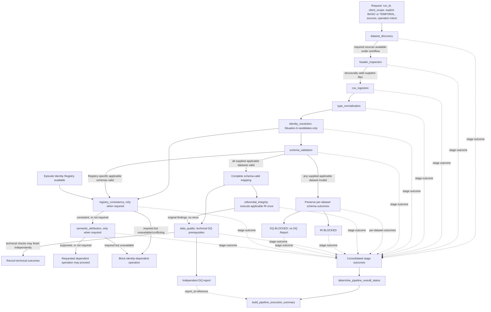

# Pipeline Orchestration Architecture Specification

**Project:** Nowa Customer Intelligence
**Scope:** PES-4A architecture specification
**Status:** Architecture specification; this document does not authorize implementation

This specification consolidates the approved ORCH-001 through ORCH-014 decisions and
defines the conceptual boundary for PES-4B implementation. Section 13 records the current
as-built implementation without changing those decisions. The Pipeline
Execution Summary (PES) specification, ADR-010, approved product decisions, and existing
component contracts remain authoritative in their respective areas. Where implementation
details are not approved or supported by current interfaces, they are identified as open.

## 1. Purpose and Scope

Pipeline orchestration coordinates the existing data-processing components for one
explicitly requested workflow. It establishes a run context, applies workflow-aware
dataset availability rules, invokes components according to their prerequisites, records
each stage outcome without losing earlier outcomes, and passes consolidated outcomes to
the PES aggregator and builder.

Orchestration coordinates validation; it does not implement or duplicate validation
rules. It does not establish identity authority, simulate Registry consistency, simulate
semantic attribution, make acceptance or eligibility decisions, or infer workflow intent.
It is not a persistence, API, UI, retry, or model-execution layer.

The processing and prediction unit remains the contractual subscription episode:
`subscription_id` identifies that episode; `customer_id` identifies its associated
customer/account and is not the prediction identifier.

## 2. Approved Orchestration Decisions

### 2.1 ORCH-001 — Explicit Workflow Declaration

Every orchestration request must declare exactly one workflow: `BASIC` or `TEMPORAL`.
The Python request uses `PipelineWorkflow`; there is no default workflow. Dataset
presence, including snapshot presence or absence, must never select the workflow.

### 2.2 ORCH-002 — Initial Identity Scope: Situation A

The initial orchestration MVP supports **Situation A** only: the client supplies
`subscription_id` values in the existing canonical-ID input shape. These are candidate
references. Their presence does not establish identity authority, correct mapping, or
Registry consistency. The identity stage may classify and carry the supplied candidates;
it must not report identity as validated solely because an ID is present or passes a
schema/RI check.

**Situation B** requires identity resolution/bootstrap. It is outside the initial MVP.
Do not invent an alternate CSV field, source identifier, evidence source, or bootstrap
behavior. Current header allowlists and schemas require canonical identifier columns and
do not support a pre-canonical input representation.

### 2.3 ORCH-003 and ORCH-011 — Registry Consistency

Registry Consistency is a separate stage from RI. RI establishes that a referenced key
exists in the supplied tables; it does not establish that the canonical ID is authoritative
or mapped to the correct contractual episode.

Registry Consistency is required whenever the requested downstream operation depends on
validated identity. Do not classify it as universally optional because the Registry or
check is unavailable. When required but not implemented, record the stage as
`NOT_IMPLEMENTED`, do not report identity validation as successful, and block the
identity-dependent operation. Independent technical checks may continue when their own
prerequisites are satisfied.

The persistent Episode Identity Registry and Registry Consistency validation are not
implemented. ADR-010 and PD-001–PD-004 requirements remain unchanged; this specification
does not design Registry storage, APIs, identity evidence, or conflict-resolution behavior.

### 2.4 ORCH-004 — Execution and Dependencies

The initial implementation uses sequential execution governed by explicit dependencies.
The dependency graph determines which stages may proceed; orchestration must not use a
single arbitrary list as a substitute for prerequisites. When a stage fails, preserve its
outcome and all previously recorded outcomes. Continue independent branches where their
prerequisites hold; mark dependent stages `BLOCKED` rather than erasing, rewriting, or
rerunning earlier results.

The orchestration layer supplies each stage's `StageRequirement`, coordinates execution,
records results, determines which dependent stages can proceed, then invokes the existing
PES aggregator and builder. Retry consolidation is outside the initial scope; input to
PES construction must already contain at most one consolidated result per `stage_id`,
consistent with PES-012.

### 2.5 ORCH-005 through ORCH-010 — Workflow Dataset Policy

| Dataset | BASIC | TEMPORAL | Approved handling |
|---|---|---|---|
| `customers` | Required; empty blocks processing. | Required; empty blocks processing. | Absence or zero records cannot be treated as a valid populated customer dataset. |
| `subscriptions` | Required; empty blocks processing. | Required; empty blocks processing. | Absence or zero records cannot be treated as a valid populated subscription dataset. |
| `subscription_snapshots` | Optional; a present-empty dataset is allowed. | Required; empty blocks temporal processing. | Absence and present-empty remain distinguishable. An empty snapshot dataset does not imply zero activity. |
| `usage_monthly` | Optional. | Optional. | A present-empty dataset is permitted under the approved proposal, subject to applicable contract validation. |
| `invoices` | Optional. | Optional. | A present-empty dataset is permitted under the approved proposal, subject to applicable contract validation. |

These policies distinguish file availability from file structure and row count:

- **Absent:** no file was supplied. Record absence in `dataset_presence`; apply the
  declared workflow's required/optional policy.
- **Present-empty:** a valid header exists but there are no data rows. Apply only the
  dataset-specific decisions in the table. Do not convert this to absence or zero-valued
  activity.
- **Header missing or invalid:** a supplied file fails structural inspection. Do not
  reinterpret it as an absent dataset.

Do not create empty-file policies for datasets or formats beyond those explicitly listed
above. A present optional dataset that fails header, ingestion, normalization, or schema
validation must not be silently ignored. Dataset optionality does not itself make a
requested operation that consumes that dataset optional; stage requirements depend on the
declared workflow and requested operation.

PD-006 remains the basis for BASIC/TEMPORAL snapshot policy. The
`ingest_client_datasets()` helper still requires snapshots unconditionally and is not used
by the MVP orchestrator. The as-built pipeline uses `ingest_csv_dataset()` per supplied
source, which supports BASIC's optional-snapshot behavior and records stage outcomes. No
ingestion behavior was changed to enable this orchestration.

### 2.6 PES-017 — Per-Dataset Stage Outcome Consolidation

Each pipeline stage included in an execution produces exactly one consolidated
`StageExecutionResult` in the Pipeline Execution Summary. That stage result must preserve
the individual outcome for every dataset processed by the stage in an immutable
per-dataset result structure. A conceptual representation is an immutable tuple of
immutable per-dataset outcomes associated with the stage result; exact Python type and
field names remain implementation details. A supplied dataset that fails must remain
represented in this structure.

Consolidate the stage status using the dataset requirements for the declared workflow and
requested operation:

| Consolidated stage status | Rule |
|---|---|
| `SUCCEEDED` | All applicable datasets completed validation successfully. |
| `PARTIAL` | All required datasets succeeded, but at least one supplied optional dataset failed. |
| `FAILED` | At least one required dataset failed. |
| `BLOCKED` | The stage could not execute because a required dependency was unavailable. |

An absent optional dataset is not a failure and has no failed per-dataset outcome. A
supplied optional dataset is not absent: if it fails validation, preserve its individual
failure outcome and consolidate the stage as `PARTIAL` when all required datasets
succeeded. That optional failure does not by itself block the main workflow when the
failed dataset is not a prerequisite for the requested downstream operation. Dependency
blocking remains operation-specific and is recorded for the dependent stage.

PES-017 defines this stage-level consolidation; it does not change PES-009/PES-016. The
existing overall-status aggregator consumes the single consolidated stage result and its
stage-level `StageRequirement`. Thus a required stage consolidated as `PARTIAL` contributes
`PARTIAL` under PES-009, while optional and not-applicable stages retain their existing
neutral treatment. Dataset-level required/optional classification does not replace the
stage-level requirement classification.

### 2.7 ORCH-013 — Referential Integrity and Registry Consistency Independence

Referential Integrity (RI) and Registry Consistency are separate validation
responsibilities and must not have a mandatory dependency on each other's execution or
results:

1. **Referential Integrity** depends on successful applicable Schema Validation and, for
   the initial MVP, the complete-mapping gate in ORCH-014. Execute RI-001 through RI-004
   once, as applicable, and pass the original findings unchanged to the DQ coordinator. RI
   checks reference existence; it does not establish identity authority or Registry
   consistency.
2. **Registry Consistency** depends on available candidate identity references, successful
   applicable Schema Validation, and an available Episode Identity Registry. It does not
   depend on RI execution or RI findings. It is required when the requested downstream
   operation depends on validated identity. If required but unavailable or not implemented,
   dependent identity operations remain blocked; independent technical checks may continue.
3. **Data Quality** depends on successful applicable Schema Validation, the ORCH-014
   complete-mapping gate for the initial MVP, and the original RI findings. It must not
   rerun RI. Registry Consistency is not a DQ prerequisite.

### 2.8 ORCH-014 — DQ Execution Requires Complete Schema-Valid Supplied Dataset Mapping

For the initial MVP, RI and DQ may execute only when every supplied, applicable dataset
has passed Schema Validation. If any supplied, applicable dataset fails schema validation,
do not execute RI or DQ; record both stages as `BLOCKED` and preserve every individual
schema outcome under PES-017. Do not omit an invalid dataset from the mapping to simulate
absence, and do not produce a partial or misleading DQ Report. Independent checks may
continue when their own prerequisites are satisfied.

Registry Consistency is evaluated against its own prerequisites: it may proceed only when
candidate identity references are available, the schemas applicable to that check have
passed, and the Episode Identity Registry is available. An unrelated schema failure does
not by itself block Registry Consistency when those prerequisites are satisfied. If all
supplied, applicable datasets pass Schema Validation, execute RI once and pass its original
findings to DQ. ORCH-014 is an initial-MVP execution policy, not a permanent architectural
limitation.

## 3. Workflow Definitions

The workflow value is an explicit request input. The table below defines dataset and
validation applicability; it does not define downstream acceptance or model eligibility.

### 3.1 BASIC

- Requires non-empty `customers` and `subscriptions` datasets.
- Allows `subscription_snapshots` to be absent or present-empty.
- Allows `usage_monthly` and `invoices` to be absent; present-empty files are allowed
  subject to contract validation.
- Runs applicable header, ingestion, normalization, and schema checks when their own
  prerequisites are satisfied. RI and DQ run only if every supplied, applicable dataset
  passes schema validation under ORCH-014. RI-003/RI-004 are
  `NOT_APPLICABLE` when their optional child dataset is absent. RI-002 is
  `NOT_APPLICABLE` when snapshots are absent.
- Snapshot absence or a valid present-empty snapshot dataset does not establish zero
  activity and does not select TEMPORAL workflow.
- Identity-dependent downstream operations still require Registry Consistency under
  ORCH-003/ORCH-011. Whether a requested operation requires that gate is determined from
  explicit request intent, not from files present.

### 3.2 TEMPORAL

- Requires non-empty `customers`, `subscriptions`, and `subscription_snapshots` datasets.
- Requires a present, structurally valid, contract-valid snapshot dataset before temporal
  processing may proceed. If snapshots are absent or present-empty, block temporal
  processing; do not represent the condition as zero activity.
- Allows `usage_monthly` and `invoices` to be absent; present-empty files are allowed
  subject to contract validation.
- Runs the same applicable structural, type, and schema validation responsibilities when
  their prerequisites hold. RI and DQ run only if every supplied, applicable dataset
  passes schema validation under ORCH-014. TC-001/TC-002 are subscription chronology checks
  and remain those rules; no snapshot-date convention, history coverage threshold, or
  temporal cutoff is introduced here.
- Snapshot availability is necessary for temporal processing but is not sufficient for
  validated identity, semantic attribution, acceptance, or model eligibility.

The exact stage-level representation of a present-empty snapshot that blocks only temporal
processing remains subject to the stage outcome mapping in Section 7. Independent technical
checks must not be mislabeled as failures merely because the downstream temporal operation
is blocked.

## 4. Conceptual Request and Result Contracts

These are conceptual orchestration inputs/outputs, not final Python signatures or an
external API contract.

### 4.1 Request

| Conceptual input | Requirement |
|---|---|
| `run_id` | Caller-supplied run identifier, consistent with PES metadata requirements. Do not generate it in the orchestrator. |
| `client_scope` | Caller-supplied pseudonymous scope. Do not generate it or expose unnecessary client-identifying information. |
| `workflow` | Required explicit `BASIC` or `TEMPORAL` value. No default and no inference from dataset presence. |
| Dataset sources | Information identifying supplied files/datasets sufficiently for discovery and ingestion. The existing code accepts a directory for `ingest_client_datasets()` or an individual file path for `ingest_csv_dataset()`; the final request representation is open. |
| Requested operation/execution intent | Explicit description of any downstream operation whose prerequisites determine whether Registry Consistency or Semantic Attribution is required. Its values and interface are open; do not invent an operation enum. |

The initial identity input is Situation A using existing canonical `subscription_id`
columns. No source-identity fields or Situation B payload are part of this request.

### 4.2 Result

The conceptual result contains:

- A `PipelineExecutionSummary`, constructed only after available stage outcomes have been
  recorded and `determine_pipeline_overall_status()` has calculated the supplied overall
  status.
- The summary's optional `dq_report_id` reference when an independent DQ report exists.
  The DQ report remains an independent artifact; its findings are not copied into the PES.
- Optional safe operational diagnostics needed to explain failures or blocked stages.
  Diagnostics must use PES-008-safe codes/messages and exclude raw rows, direct PII,
  sensitive source values, absolute paths, and unnecessary client-identifying information.

Whether the orchestration call returns the DQ report object alongside the summary or only
its reference is an implementation/API decision. It must not create a combined artifact
that duplicates DQ findings.

## 5. Stage Catalog and Requirement Classification

`StageRequirement` is supplied for each stage result as defined by PES-010/PES-011:

- `REQUIRED`: the stage must complete for the declared workflow and requested operation.
- `OPTIONAL`: the stage may be omitted or fail without invalidating required processing.
- `NOT_APPLICABLE`: the stage is outside the declared workflow or requested operation;
  the status must also be `NOT_APPLICABLE` under PES-015.

Classification is per execution context, not an intrinsic property of a stage and not
inferred from dataset presence. An absent optional dataset may make a dataset-specific
operation unnecessary, but the exact representation as `OPTIONAL`/`SKIPPED` or
`NOT_APPLICABLE` depends on the final stage grouping contract and remains open. Never mark
a required-but-unimplemented capability optional to avoid blocking its dependent
operation.

| Stage ID | Responsibility and prerequisites | Downstream dependencies | Workflow requirement/applicability | Current state and initial MVP executability |
|---|---|---|---|---|
| `dataset_discovery` | Identify supplied datasets, explicit workflow, and per-workflow required/optional presence and approved empty conditions. | Gates structural inspection/ingestion for missing required sources and workflow-specific data paths. | Required for every request. Apply the dataset matrix in Section 2.5; optional dataset absence is recorded, not treated as zero or a generic failure. | Implemented by `pipeline.execute_pipeline()` through `discover_datasets()`, which records presence, validates source paths, and creates the discovery outcome. |
| `header_inspection` | Validate the header of each supplied dataset before trusting its columns; missing files are handled by discovery, not reclassified as header errors. | CSV ingestion, then normalization and downstream technical checks. | Required for supplied datasets needed by the request; no operation for an absent optional file. Preserve per-dataset outcomes and consolidate the stage under PES-017. | Implemented in the technical pipeline through `ingest_csv_dataset()`, which invokes header inspection once per supplied file and preserves per-dataset outcomes. |
| `csv_ingestion` | Parse structurally acceptable CSV data while preserving values as strings and row-width errors. | Type normalization. | Required for supplied datasets needed by the request. Missing optional datasets are recorded absent and not parsed. | Implemented in the technical pipeline using per-file `ingest_csv_dataset()` calls, allowing BASIC to omit snapshots. |
| `type_normalization` | Apply explicit contract conversions; preserve identifiers exactly and fail invalid values without silent repair. | Schema validation. | Required for each supplied dataset entering technical validation; preserve each outcome and consolidate mixed required/optional results under PES-017. | Implemented in the technical pipeline; per-dataset normalization outcomes are retained and consolidated. |
| `identity_resolution` | Initial MVP treats supplied canonical `subscription_id` values as candidate references (Situation A). This does not validate authority or mapping. | Candidate IDs are available to schemas and RI that require those columns; validated identity still depends on Registry Consistency when required. | Required when candidate episode references are needed by the requested checks/operation; otherwise `NOT_APPLICABLE` only when identity is genuinely outside the request. Situation B is outside the MVP. | No separate stage is emitted by the seven-stage MVP pipeline. Supplied `subscription_id` values remain candidate references; no identity authority or mapping validation is claimed. |
| `schema_validation` | Run the existing Pandera schema for each supplied, normalized dataset and preserve every individual outcome under PES-017. Do not repeat identity checks or cross-file validation. | RI and DQ require all supplied, applicable datasets to pass; Registry Consistency requires only its own applicable schemas to pass. | Required for each supplied dataset used by the requested technical or downstream operation. A present invalid optional dataset must not be silently converted to absent. | Implemented for all five schemas in the technical pipeline; individual outcomes and validated frames are retained. |
| `referential_integrity` | Under ORCH-013/014, run RI-001–RI-004 once only after all supplied, applicable datasets pass Schema Validation. It checks reference existence only. | Its original findings are passed unchanged to DQ; RI does not depend on Registry Consistency and does not establish identity authority. | Required for applicable relationships in the requested workflow. If any supplied, applicable dataset fails schema validation, RI is `BLOCKED`. Optional child rules are `NOT_APPLICABLE` when that dataset is absent, as existing RI behavior specifies. | Implemented through the DQ coordinator after the complete supplied mapping passes schema validation; RI runs once and its original findings are supplied to DQ. |
| `registry_consistency` | Verify candidate canonical IDs/mappings against the persistent client-scoped Episode Identity Registry; requires candidate references, successful schemas applicable to this check, and Registry availability. It does not depend on RI or the all-dataset gate in ORCH-014. | Gates only identity-dependent operations; it does not gate independent RI or DQ technical validation. | `REQUIRED` when the requested downstream operation depends on validated identity; `NOT_APPLICABLE` only when no requested operation depends on it. Never universally optional. | Registry and check are not implemented. When required, report `NOT_IMPLEMENTED`; block dependent operations and continue independent technical checks. |
| `data_quality` | Under ORCH-014, coordinate applicable DQ rules only after all supplied, applicable datasets pass schema validation and RI has executed once; consume the original RI findings, execute TC-001/TC-002, and create the DQ-only report. | DQ blocking findings gate affected downstream data use. DQ must not rerun RI and does not depend on Registry Consistency. | Required when the requested workflow includes DQ technical validation. If any supplied, applicable dataset fails schema validation, record DQ as `BLOCKED` and do not produce a DQ Report. | Implemented through `orchestrate_referential_integrity_and_data_quality()` and called once by the public entry point; the coordinator owns RI/DQ sequencing and report creation. |
| `semantic_attribution` | Assess whether dependent records are supported as belonging to their referenced contractual episodes. No evidence algorithm is defined here. | Required attribution gates use of dependent records as episode-linked data; it is distinct from candidate resolution, RI, and Registry Consistency. | Depends on workflow and requested operation. Required when the operation consumes dependent records as episode-attributed; otherwise `NOT_APPLICABLE` only if not part of the operation. | Not implemented. If required, record `NOT_IMPLEMENTED` and block the dependent operation; do not simulate a pass. |

### 5.1 Stage Outcome Scope

Under PES-017, each stage included in an execution produces one consolidated result and
retains each processed dataset's individual outcome in an immutable per-dataset structure.
The stage status follows the rules in Section 2.6. This structure is implemented as the
immutable `dataset_results` tuple of immutable `DatasetStageResult` values in
`StageExecutionResult`. The public pipeline preserves these outcomes through PES
construction. The concrete per-dataset field names and immutable representation are
implemented; count scope and semantics, and mapping of outcomes beyond the approved
consolidation cases remain open.

## 6. Dependency Model and Execution Flow

Execution is sequential, with eligibility for each next stage determined by explicit
dependencies. The following relationships are the approved dependency graph; they are not
a requirement to run every listed stage for every workflow.



The graph preserves these constraints:

1. Header inspection precedes CSV ingestion; ingestion precedes normalization; normalization
   precedes schema validation.
2. Situation A candidate references are available before schemas, RI, and any required
   Registry Consistency check that depend on `subscription_id`. Candidate presence is not
   Registry validation.
3. Under ORCH-014, RI and DQ execute only when the complete supplied, applicable mapping
   passes Schema Validation. If any supplied, applicable dataset fails, both stages are
   `BLOCKED`; preserve each dataset's schema outcome and do not produce a DQ Report. Do not
   omit an invalid dataset to simulate absence.
4. When that complete schema gate passes, RI executes once. Its four findings are carried
   unchanged into `validate_data_quality(...)`; DQ must not rerun RI. The current DQ
   coordinator also evaluates TC-001/TC-002 and constructs an independent DQ report.
5. Under ORCH-013/014, Registry Consistency depends on candidate references, its own
   applicable schemas, and Registry availability, but not RI or the all-dataset gate. It
   gates identity-dependent operations, not independent technical checks.
6. Semantic Attribution is separate from candidate identity resolution, RI, and Registry
   Consistency. It must not be simulated if the capability is absent.
7. Once the available stage outcomes are consolidated, invoke the overall aggregator once;
   pass its supplied result to the PES builder. The builder does not aggregate, and neither
   step reruns validation.

The current `ingest_csv_dataset()` calls `inspect_csv_header()` internally. A future
adapter must capture the header-versus-ingestion outcome without calling header inspection
twice. A `CSVHeaderError` indicates the structural stage failed before parsing; a later
`CSVIngestionError` indicates ingestion failed after the integrated header check passed.
This is a component-integration constraint, not permission to modify component validation
rules in PES-4A.

## 7. Failure, Blocking, and Stage Outcome Handling

Use the existing `StageExecutionStatus` values without redefining their PES-001 meanings:

| Condition | Stage result | Dependency handling |
|---|---|---|
| Component completes its responsibility | `SUCCEEDED` | Eligible dependents may proceed if their other prerequisites hold. Success means that component completed; it does not establish acceptance, identity authority, or model eligibility. |
| Component executes and fails | Interpret under PES-017 for a stage processing multiple datasets: `FAILED` if any required dataset validation fails; `PARTIAL` if failure affects only supplied optional datasets and all required datasets succeeded. | Preserve every dataset outcome; mark a dependent stage `BLOCKED` only when a required dependency is unavailable. Independent stages may proceed where permitted. |
| A prerequisite failed or is unavailable | `BLOCKED` for the dependent stage | Preserve the prerequisite outcome; do not rerun or relabel it. |
| A stage completes only part of its intended processing | `PARTIAL` | Preserve each processed dataset outcome under PES-017; dependent behavior follows its explicit prerequisites. Count scope remains open. |
| Stage is deliberately omitted by execution control | `SKIPPED` | Do not use it as a substitute for dependency failure, non-applicability, or missing implementation. |
| Stage does not apply to this workflow/operation | `NOT_APPLICABLE` | Set `requirement=NOT_APPLICABLE` as required by PES-015. Do not infer applicability from file presence alone. |
| Required capability is absent | `NOT_IMPLEMENTED` | Do not report it as successful; block only the dependent operation. Independent checks may continue. |

Additional controls:

- Required missing datasets and required empty datasets block the affected workflow path
  according to Section 2.5. Do not reinterpret a missing header or invalid supplied file
  as an absent optional dataset.
- An absent optional dataset is recorded as absent and is not a failure. Existing RI rules
  for absent optional child datasets report `NOT_APPLICABLE`; the PES stage-level roll-up
  for absent dataset-specific inspection is still to be finalized under Section 5.1.
- A supplied optional dataset that is malformed is not silently skipped. Its validation
  outcome must remain represented in the immutable per-dataset outcomes under PES-017.
  Failure exclusively affecting supplied optional datasets produces `PARTIAL` when all
  required datasets succeeded for the stage processing those datasets. Under ORCH-014, a
  supplied optional dataset's schema failure also blocks RI and DQ for the initial MVP,
  even if that dataset is not otherwise a requested-operation prerequisite. Other
  independent checks may continue, and Registry Consistency may proceed if its own
  prerequisites are satisfied. If the requested operation itself requires that dataset,
  classify it as required for that execution; its validation failure produces `FAILED` for
  the stage processing it.
- A missing required dependency produces `BLOCKED` for the dependent stage; it is distinct
  from a validation failure in a dataset the stage was able to process.
- Under ORCH-014, if any supplied, applicable dataset fails Schema Validation, do not
  execute RI or DQ; record both stages as `BLOCKED`, preserve all per-dataset schema
  outcomes, and do not produce a DQ Report. Do not remove the invalid dataset from the
  mapping. This complete-mapping gate is specific to RI and DQ in the initial MVP.
- Registry Consistency may proceed independently of the all-dataset RI/DQ gate only when
  its candidate identity, applicable schema, and Registry availability prerequisites are
  satisfied.
- If Registry Consistency is required but unavailable, record
  `requirement=REQUIRED`, `status=NOT_IMPLEMENTED`; dependent identity operations are
  `BLOCKED`. Continue schema, RI, and DQ technical checks if their own prerequisites are
  satisfied.
- If Semantic Attribution is required but unavailable, record
  `requirement=REQUIRED`, `status=NOT_IMPLEMENTED`; block the operation that needs
  episode-attributed dependent records. Do not create supported/unsupported outcomes by
  heuristic.
- A DQ finding with runtime result `FAIL` and blocking scope remains in the DQ Report.
  Do not copy findings into PES. The mapping between DQ rule failures and the execution
  status of the `data_quality` stage must reflect whether the DQ component executed and
  produced its report; it must not erase the DQ blocking result.
- Preserve every outcome already recorded when later stages fail. Create one consolidated
  `StageExecutionResult` per `stage_id`; do not implement retries or attempt history.

The PES aggregator applies PES-009 only after stage outcomes and requirement
classifications have been supplied. It is the sole owner of overall-status calculation;
the orchestration layer must not reproduce its precedence logic. The PES builder is the
sole owner of summary construction and must receive the aggregator's returned status.

## 8. Integration with Existing Components

| Component | Orchestration integration | Boundary |
|---|---|---|
| Header inspection | Inspect each supplied file before trusting its contract columns; capture `CSVHeaderError` safely. | Does not normalize or read/validate data rows. |
| CSV ingestion | Parse each supplied dataset after structural success; preserve strings and row-width errors. | Does not change identifiers or infer dataset absence. The directory loader currently requires snapshots; use must respect explicit workflow. |
| Type normalization | Convert recognized contract values after successful ingestion. | No silent repair; contextual errors are sanitized before PES messages. |
| Pandera schemas | Apply the matching schema to normalized supplied frames. | Own single-frame type, nullability, uniqueness, and value checks. Orchestration must not duplicate them. |
| Referential Integrity | Run `validate_referential_integrity()` once only after all supplied, applicable datasets pass schema validation and required candidate IDs are available. | Own RI key-existence checks; pass the original tuple to DQ coordination. Does not prove identity authority or attribution, or depend on Registry Consistency. |
| Temporal Consistency / DQ coordinator | Only after the complete supplied, applicable mapping passes schema validation and RI has run once, `validate_data_quality()` accepts that mapping and the original RI findings; it invokes TC-001/TC-002 and returns a DQ-only report. | If any supplied, applicable dataset fails schema validation, the orchestration stage is `BLOCKED` and no DQ Report is produced. Does not run upstream stages, rerun RI, check Registry consistency, or decide acceptance. |
| DQ report builder | Used by the DQ coordinator to produce the independent `DataQualityReport`. | DQ report is referenced from PES by `dq_report_id`; findings are not copied. |
| PES aggregator | `determine_pipeline_overall_status(stages)` after outcomes are consolidated. | Sole overall-status calculation under PES-009/PES-016. |
| PES builder | `build_pipeline_execution_summary(...)` from metadata, supplied aggregate status, consolidated stages, and presence map. | Constructs immutable PES; does not execute, retry, consolidate, or aggregate. |

No validation rules move into orchestration. Orchestration owns workflow-aware selection,
dependency checks, safe exception-to-stage outcome mapping, and component invocation only.

### 8.1 Current Integration Limitations

PES-4B implements the public `pipeline.execute_pipeline(request)` entry point with an
explicit `PipelineWorkflow` (`BASIC` or `TEMPORAL`), workflow-aware dataset discovery,
technical processing, the ORCH-014 gate, RI/DQ coordination, and final PES construction.
It preserves the seven established stage IDs and PES-017 per-dataset outcomes. The
aggregator alone calculates overall status, and the finalizer uses the existing PES builder.

The current entry point supports Situation A candidate `subscription_id` references only;
it does not emit a separate identity-resolution stage or claim that candidate references
are authoritative. Registry, Registry Consistency, Situation B, Semantic Attribution,
acceptance/eligibility, persistence, external API/UI, and live-client-data processing
remain outside the MVP. Remaining architecture questions include how to represent a
schema-valid but empty required dataset as a PES stage outcome; currently the entry point
raises `PipelineOperationalInputError` with discovery and technical results and returns no
PES for that case. Other pending decisions and dependencies remain as listed in Section 10.

The DQ coordinator requires schema-valid datasets and derives its `dataset_presence` from
the mapping it receives. Under ORCH-014, PES-4B must not omit a supplied-but-invalid
optional dataset to call DQ, because that would misrepresent it as absent. If any supplied,
applicable dataset fails schema validation, RI and DQ are `BLOCKED`, no DQ Report is
produced, and all individual schema outcomes remain preserved under PES-017. This is the
approved initial-MVP policy; the specification does not add partial DQ behavior.

## 9. PES-4B Candidate Package Organization

The following minimal organization is a proposal for implementation planning, not a
mandatory file list or authorization to create files in PES-4A:

```text
src/nowa_customer_intelligence/pipeline/
├── __init__.py          # public orchestration API, if approved
├── models.py            # existing PES enums and immutable models
├── aggregation.py       # existing overall-status aggregator
├── reporting.py         # existing PES builder
├── workflows.py         # proposed explicit BASIC/TEMPORAL declaration
├── stages.py            # optional thin adapters for existing component outcomes
└── orchestration.py     # proposed dependency-aware sequential coordinator
```

Avoid an abstraction layer that duplicates validation or an adapter per file unless
needed to preserve stage outcomes. `stages.py` must not own schema, RI, TC, or DQ rules.
The exact public request/result models and export surface remain open. Do not introduce
new PES enums or model fields under PES-4A.

## 10. Open Decisions and PES-4B Dependencies

The following must remain unresolved until separately designed or confirmed:

1. How trusted workflow context is supplied to callers; the request requires an explicit
   `PipelineWorkflow` and has no implicit BASIC or TEMPORAL default.
2. Exact representation of requested downstream operations and how they determine
   conditional `Registry Consistency` and `Semantic Attribution` requirements.
3. Situation B input representation, source identifiers, and identity evidence; Situation
   B is outside the initial MVP.
4. Episode Identity Registry implementation and Registry Consistency interface.
5. Semantic Attribution evidence, algorithms, and implementation.
6. Stage-level representation of a valid but empty required dataset. The current public
   entry point fails fast after technical validation and preserves discovery/technical
   results on `PipelineOperationalInputError`; it does not construct a PES for that run.
   A future decision is needed if this condition must appear in a PES using the established
   seven-stage model. Present-empty TEMPORAL snapshot stage outcomes also remain open.
7. Error-code vocabulary and safe operational messages beyond the current implementation.
8. PES/DQ report result wrapper, serialization, persistence, and operational retention.
9. Detailed dependency/stage ordering where a component combines multiple responsibilities
   or a requested operation does not require every stage.
10. Any dataset empty-file behavior not explicitly approved in Section 2.5.

Existing DD-EP/client decisions, snapshot date convention, temporal coverage/evaluation
strategy, identity exchange format, and data-contract changes remain outside this document.

## 11. PES-4B Implementation Boundaries

PES-4A is documentation and architecture specification only; it authorizes no code or
contract change. The code described in Section 13 was implemented under separate PES-4B
tasks and does not expand the approved product or validation scope.

The current MVP does not implement:

- Episode Identity Registry or Situation B identity resolution/bootstrap.
- Registry Consistency checks.
- Semantic Attribution.
- Acceptance, partial acceptance, exclusion, or feature/training/prediction eligibility.
- Persistence, serialization infrastructure, API, UI, or monitoring.
- Retry consolidation or retry history.
- New CSV fields, source identifiers, business rules, or changes to existing validation.

## 12. Verification Approach for PES-4B

Implementation tests should use synthetic fixtures and verify at minimum:

- Explicit workflow is required and never inferred from dataset presence.
- BASIC/TEMPORAL dataset matrix, absent versus present-empty versus header-missing
  behavior, and no policy for unlisted empty cases.
- Sequence/dependency behavior, preserved earlier stage results, and independent technical
  validation continuing when a later Registry-dependent operation is blocked.
- Situation A candidate identity is never represented as Registry-validated identity;
  Situation B remains unsupported.
- RI runs exactly once and its findings are passed into DQ coordination; DQ rules and
  schema checks are not duplicated.
- Registry and Semantic Attribution are `NOT_IMPLEMENTED` when required, with dependent
  operations blocked and no simulated success.
- The aggregator alone calculates overall status and the builder alone constructs PES.
- DQ report and PES remain separate, and safe reports do not expose raw rows, direct PII,
  sensitive source values, paths, or unnecessary client-identifying details.

## 13. PES-4B-6 As-Built MVP Integration

The public entry point is `pipeline.execute_pipeline(request)`. It invokes the existing
components once and in this order:

1. `discover_datasets(request)`.
2. `run_technical_pipeline(request, discovery)` for integrated header inspection/CSV
   ingestion, type normalization, and all applicable Pandera schemas.
3. The ORCH-014 schema gate and, when eligible, RI followed by the DQ Coordinator. TC-001
   and TC-002 run only inside the DQ Coordinator.
4. `build_final_pipeline_result(...)`, which calls the existing overall-status aggregator
   and PES builder and returns `PipelineOrchestrationResult`.

The final PES contains these seven stage IDs in order: `dataset_discovery`,
`header_inspection`, `csv_ingestion`, `type_normalization`, `schema_validation`,
`referential_integrity`, and `data_quality`. Original stage objects, requirement
classifications, and per-dataset outcomes are preserved. A validation finding with result
`FAIL` does not by itself mean that its RI or DQ execution stage failed.

The implementation applies the Section 2.5 dataset matrix. Absent optional datasets do not
block execution. Present-empty optional snapshots are allowed in BASIC; present-empty
`usage_monthly` and `invoices` are allowed in either workflow subject to schema validation.
Required `customers` and `subscriptions` must contain rows in both workflows, and required
TEMPORAL snapshots must contain rows. When a supplied required dataset is schema-valid but
empty, `execute_pipeline` raises `PipelineOperationalInputError` after technical
validation and before RI/DQ. The exception carries the request, discovery result, and
technical result; it contains no source path or row values. No successful PES or DQ Report
is returned for that input.

The seven-stage PES has no separate operational-readiness or temporal-eligibility stage.
The exception is a fail-safe boundary, not a stage-status mapping. If a PES must be
returned for present-empty required inputs, an approved stage/result representation is
still needed; this implementation does not relabel schema success as schema failure or
invent a new stage/status.

The PES summary ID uses UUIDv4, following the existing DQ Report ID convention; its
creation timestamp uses timezone-aware UTC now. The MVP does not implement the Episode
Identity Registry, Registry Consistency, Situation B, Semantic Attribution, acceptance or
eligibility, persistence, an external API/UI, or live-client-data processing. The opaque
`execution_intent` does not determine applicability for those capabilities.

