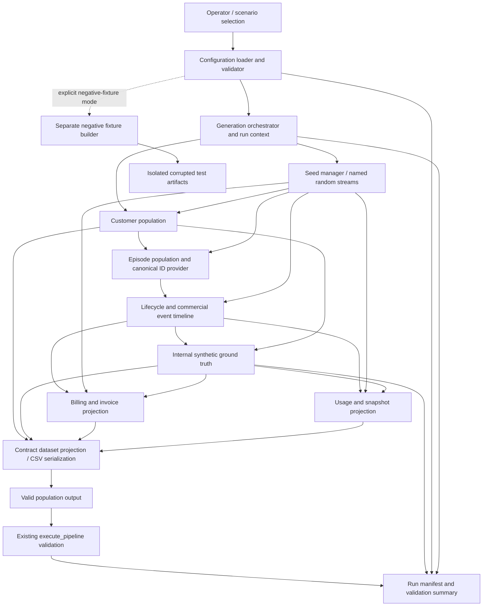

# Synthetic Data Generation Architecture

**Document ID:** NCI-SYNTH-ARCH-001
**Version:** 0.1
**Status:** Approved for Design Baseline
**Project:** Nowa Customer Intelligence
**Market context:** United Kingdom (GB)
**Scope:** Logical design and configuration strategy only. No generator, configuration file, or dataset is implemented here.

## 1. Executive Summary

This document proposes a small, modular architecture for a future synthetic SaaS population generator. It combines generation architecture (Activity 3.3.3.1) and population/scenario configuration (Activity 3.3.3.2) as one design. A single orchestrator should coordinate validated configuration, named deterministic random streams, customer and episode ground truth, lifecycle events, billing, usage, snapshots, serialization to the five contract datasets, and validation through the existing pipeline.

The **APPROVED DECISION** and **EXISTING IMPLEMENTATION CAPABILITY** statements below are distinguished from **PROPOSED ARCHITECTURAL DECISION**, **PROPOSED SYNTHETIC ASSUMPTION**, **OPEN DECISION**, and **TECHNICAL RISK**. This design does not implement or approve a generator or change the Customer Data Contract.

The recommended configuration format is YAML with explicit schema/version metadata, validated before generation using a small typed configuration model. PyYAML and Pydantic are already project dependencies. Named scenarios should share one generation path and alter only validated parameter values. The five Customer Data Contract v1.1 datasets form the supported inventory. The declared workflow, contract v1.1, approved PD-006 and applicable pipeline requirements determine the required inventory for each execution. Initial BASIC validation requires `customers.csv` and `subscriptions.csv`. Snapshots are optional in BASIC and required in TEMPORAL. Other optional inputs follow the contract and workflow requirements. Keep the run manifest and ground-truth artefact separate from the contract CSVs and their headers.

Important current limitations include: direct `ingest_client_datasets` requires snapshots even for basic use; the orchestration API supports BASIC without snapshots and TEMPORAL with snapshots; the existing RI checks verify key existence but not semantic episode attribution; temporal validation currently checks only end/cancellation date ordering; and the pipeline has no Episode Identity Registry, episode-attribution resolver, or synthetic generation code. Repository documentation also contains some stale Data Quality implementation status descriptions that should be reconciled separately.

## 2. Scope and Objectives

### In scope

- Logical generation components, responsibilities, dependencies, and ordering.
- Separate synthetic ground truth from contract-shaped output tables.
- Separate valid model-development populations from intentionally corrupted fixtures.
- Configuration and scenario strategy, parameter coverage, and reproducibility expectations.
- Integration boundary with the current Nowa CSV-to-pipeline workflow.
- Design risks, approvals, and readiness inputs for Block B.

### Out of scope

- Python module/API design beyond illustrative logical boundaries.
- Generator, configuration loader, configuration file, population records, CSV files, or validation code.
- Episode Identity Registry implementation or identity-resolution algorithms.
- Customer Data Contract, schema, ADR, or product decision changes.
- Production churn definition, official CLV formula, migration, or real-client data processing.

## 3. Source Documents and Constraints

### 3.1 Source availability

Reviewed the approved [Synthetic Business Model Specification v0.2](synthetic_business_model_specification.md), [Customer Data Contract v1.1](customer_data_contract.md), [ADR-009 and architecture decisions](../03_architecture/architecture_decisions.md), [ADR-010](../03_architecture/adr_episode_identity_and_identifier_management.md), [Subscription Episode & Lifecycle Decision Specification v0.4](subscription_episode_lifecycle_decision_specification.md), [approved product decisions](product_decision_proposals.md), [product decision assessment](product_decisions_and_contract_design_assessment.md), [Data Sources and Governance](data_sources_and_governance.md), [Data Quality Specification](data_quality_specification.md), [pipeline orchestration specification](../03_architecture/pipeline_orchestration_specification.md), [data quality implementation architecture](data_quality_implementation_architecture.md), and relevant source modules, schemas, and integration tests.

**NEDS v1.1 source and assessment:** NEDS v1.1 was not found in the repository. The authoritative document was available in the project reference material and was reviewed; formal design alignment can therefore be assessed against its contents. Section 4.1 records that assessment. Implementation compliance remains subject to evidence from a future implementation and review. The approved Phase 3.3.1 population specification was provided in the preceding conversation but is not saved as a repository file. Its assumptions are incorporated here from that conversation: initial proposal of 1,000 accounts, 1,100–1,400 episodes, 36 months of history, configurable population size and proportions, and reproducibility.

### 3.2 Binding approved constraints

- **APPROVED DECISION:** `customer_id` identifies the customer/account; the prediction entity is an individual contractual subscription episode.
- **APPROVED DECISION:** Nowa owns canonical `subscription_id`; UUID is the initial strategy. Generate once for an authoritatively established episode, persist and reuse. UUID version and technical mechanism are not selected.
- **APPROVED DECISION:** A persistent, client-isolated Episode Identity Registry is required. It is not implemented.
- **APPROVED DECISION:** One customer may have multiple episodes. Confirmed reactivation after termination creates a new episode; prior episode history remains preserved.
- **APPROVED DECISION:** Ambiguous/conflicting identity must remain visible and unresolved; no date/status/row-order/heuristic inference. Approved product decisions PD-002 and PD-003 prohibit automatic ID issue/reuse in ambiguous identity cases and exclude unresolved identity records from identity-dependent processing.
- **APPROVED DECISION:** `customer_id` is not a predictive feature. Customer-level CLV aggregation remains distinct from episode-level churn prediction.
- **APPROVED DECISION:** Synthetic values are engineering data, not evidence of model performance on real populations.
- **APPROVED DECISION:** Snapshot datasets are optional for basic ingestion and required for temporal-modelling workflows under PD-006. The direct loader has not been aligned with this decision.

### 3.3 Approved business-model configuration anchors

The configuration baseline must reflect the approved v0.2 synthetic business specification, not infer UK market facts:

- **PROPOSED SYNTHETIC ASSUMPTION:** Fieldwise Cloud Ltd; Launch, Growth, Scale, Enterprise; GBP baseline; monthly and annual billing; 10% annual discount.
- **PROPOSED SYNTHETIC ASSUMPTION:** Monthly `recurring_revenue` equals the monthly invoice amount. Annual invoice amount is monthly list price × 12 × (1 − discount); `recurring_revenue` is annual invoice amount divided by 12 and is the same monthly-normalised amount in subscriptions and snapshots. Annual invoice rows contain the full annual amount.
- **PROPOSED SYNTHETIC ASSUMPTION:** No baseline charge, invoice line, overage, or proration for additional seats. Seat changes may affect usage but not recurring revenue.
- **PROPOSED SYNTHETIC ASSUMPTION:** Plan upgrade/downgrade occurs within the existing episode and does not automatically create a new ID; later snapshot and next-billing-date invoice state may change.
- **PROPOSED SYNTHETIC ASSUMPTION:** One active episode per customer by default; sequential reactivation is optional and receives a new canonical UUID when synthetic ground truth establishes it.
- **OPEN DECISION:** Production recurring-revenue semantics, lifecycle boundaries, renewal/extension treatment, churn qualification, snapshot convention, usage boundaries, FX policy, and official CLV formula remain unresolved.

## 4. Architecture Principles

| Principle | Application | Classification |
|---|---|---|
| One-way data flow | Generate parent entities and lifecycle truth before dependent tables; serialize only after all inputs exist. | PROPOSED ARCHITECTURAL DECISION |
| Shared truth, separate projections | Subscriptions, snapshots, usage, invoices, and labels derive from one internal episode/event truth; each output remains a contract-shaped projection. | PROPOSED ARCHITECTURAL DECISION |
| Contract boundary is strict | Output only the five v1.1 dataset schemas with approved headers; keep metadata in separate artifacts. | APPROVED constraint / PROPOSED ARCHITECTURAL DECISION |
| Identity is assigned, never inferred | Create synthetic canonical UUIDs as part of known synthetic episode creation; dependent records receive the known episode key directly. Do not simulate source resolution by heuristics. | APPROVED identity principle applied to synthetic design |
| Separate valid and invalid data | Negative fixtures are opt-in test artifacts and never enter valid population output or training folders. | PROPOSED ARCHITECTURAL DECISION |
| Reproducibility is explicit | Same effective configuration, generator version, dependency environment, and seed should reproduce data and manifest, subject to approved identity-provider behavior. | PROPOSED ARCHITECTURAL DECISION; UUID implementation remains open |
| Small modular monolith | Use functions/modules by responsibility under one local generation command; no service mesh, plugin system, distributed queue, or generic workflow engine. | PROPOSED ARCHITECTURAL DECISION |
| Validate through existing contracts | Serialize first, then invoke the existing file-based pipeline entry point; preserve its results rather than duplicating schema/RI rules in the generator. | PROPOSED ARCHITECTURAL DECISION |

### 4.1 NEDS v1.1 alignment matrix

| NEDS area and relevant requirement | Architecture response | Remaining implementation consideration |
|---|---|---|
| Architecture and modularity: separate concerns, define responsibilities, prefer simple maintainable architecture. | One local orchestrator coordinates bounded generation, projection, serialization, and validation responsibilities; no distributed infrastructure is proposed. | Keep interfaces explicit and avoid splitting components into infrastructure without demonstrated need. |
| Configuration and dependency management: separate configuration from implementation; control dependencies and avoid hardcoded environment-specific values. | Versioned YAML scenarios are validated before generation; existing PyYAML/Pydantic dependencies are recommended for reuse. | Define the supported configuration schema and pin/manage dependencies in the implementation workflow. |
| Data management and data quality: document sources and lineage; validate schema, types, keys, relationships, and quality; protect sensitive data. | Synthetic assumptions, ground truth, contract projections, manifests, and pipeline validation are separated; contract validation and referential integrity retain their existing scopes. | Implement checks for generated invariants and provenance; separately verify semantic episode attribution and temporal correctness, which schema/RI checks do not establish. |
| Reproducibility: use documented procedures, controlled dependencies, and versioned code. | Effective configuration, generator/runtime versions, seed streams, hashes, and run identity are recorded; named RNG streams support repeatability. | Resolve UUID replay behavior and establish dependency/version capture and repeatability evidence. |
| Logging and error handling: reliability requires appropriate validation, error handling, logging, and monitoring. | The run design logs stage starts, completions, counts, durations, and failures, and stops dependent processing after a failed stage. | Select structured log fields and retention appropriate to the eventual execution environment; do not expose sensitive truth in logs. |
| Testing strategy: appropriate unit, integration, end-to-end, and data testing for production-oriented components. | Future tests are assigned to component invariants, projection/serialization/pipeline interactions, and complete deterministic runs including failure paths. | Implement and execute the applicable tests before treating a generator as production-ready. |
| Security and data protection: least privilege, access control, sensitive-data protection, secure handling. | Ground truth is separate from contract outputs, uses synthetic identifiers, and is treated as a restricted run artifact; logs avoid truth payloads. | Define access roles, output permissions, retention, and cleanup for the execution environment. |
| Documentation and British English: documentation must be clear, accurate, reflect implementation, and use British English. | This design distinguishes approved decisions, proposals, open decisions, and current capabilities and records current limitations. | Keep future documentation and code comments in British English and update design claims against actual implementation. |
| Technical justification and scope control: justify significant choices and avoid unnecessary complexity. | A small modular monolith, existing pipeline, and existing dependencies are preferred; unresolved decisions remain explicit. | Record implementation choices and exceptions with rationale; retain the stated open decisions until approved. |

## 5. Logical Component Architecture

The components below are logical responsibilities, not a mandate for one module per box. A first implementation should keep them in a small package with explicit data structures and direct function calls.

The run manifest and ground-truth artifacts are separate from the five contract datasets. The diagram’s negative fixture branch is an explicit separate mode, not a transformation applied to valid output.

## 6. Component Responsibilities

| Logical component | Purpose and inputs | Outputs and dependencies | Boundaries and validation |
|---|---|---|---|
| Configuration loader and validator | Read one versioned scenario document and optional named-scenario overrides. Check types, ranges, allowed plan IDs, date ordering, cross-parameter constraints, and unsupported keys before generating. | Immutable effective configuration plus validation errors. Depends on YAML parser and config schema/model. | Does not generate values or fill missing assumptions silently. Reject unknown keys and invalid combinations. YAML/Pydantic are existing dependencies; reuse is a proposal, not an implementation decision. |
| Generation orchestrator / run context | Create run identity, resolve effective scenario parameters, establish fixed observation window and component RNG streams, call generation stages in order. | In-memory stage results and final output locations. Depends on configuration and the components below. | One clear entry point; does not encode business distributions itself. Stop before serialization if required upstream state is invalid. |
| Seed manager | Derive named pseudo-random streams from a master seed for customer, episode, lifecycle, billing, and usage generation. | Independent deterministic RNG objects and recorded seed metadata. | Avoid global random state and order-dependent draws. Do not use Python’s process-randomized `hash()` for seed derivation. Same component should retain its stream when unrelated components are added. |
| Customer population generator | Apply account count and configurable segment, geography, industry, and creation-date parameters. | `customers` projection inputs and internal customer attributes. | Enforce unique non-empty customer IDs and valid contract fields. Does not set plan as a deterministic proxy for segment. |
| Episode population / canonical ID provider | Create episode count per account, start dates, plan/billing starting state, and a canonical episode ID for each explicitly created synthetic episode. | Episode ground-truth records keyed by unique UUID `subscription_id`; customer FK. | Create distinct episode IDs directly; do not infer existing/new episodes from row dates/status. UUID version/provider remains open. Confirm reactivation gets a new ID and prior episode remains. No Registry implementation. |
| Lifecycle and commercial event engine | Apply configured trial, plan change, cancellation/effective-end, pause/payment stress, and reactivation scenarios to a known episode. Track event occurrence and availability separately. | Ordered internal event timeline and state changes. Depends on episode truth and scenario parameters. | No unapproved status values in contract outputs. Keep synthetic label hypothesis separate from production label semantics. Validate event chronology against the selected scenario, not assumed universal lifecycle law. |
| Billing projection | Use episode billing cadence, plan price, annual discount, and commercial timeline to create invoice records. | `invoices` rows plus internal invoice/event detail. Depends on episodes and event timeline. | Monthly baseline recurring amount equals monthly invoice. Annual invoices are full discounted annual amount while subscriptions/snapshots store normalized monthly amount. No extra-seat charge, proration, refund allocation, or multi-episode invoice in baseline. Check amount nonnegative, due/paid dates, currency, and status against contract. |
| Snapshot and usage projection | Materialize monthly subscription state and episode-level usage profiles from episode timeline and usage parameters. | `subscription_snapshots` and optional `usage_monthly` rows. Depends on episodes, timeline, plan/usage parameters. | Enforce unique composite keys, nonnegative counts, active users ≤ total users, and known episode FK. Snapshot and usage period conventions remain parameters/open decisions. No cross-episode assignment or allocation. |
| Ground-truth manager | Maintain authoritative generated accounts, episodes, event timeline, invoice facts, usage facts, event availability, censoring/label hypotheses, scenario assumptions, and identity manifest. | Internal typed structures/artifact separate from contract projections. Shared read-only source for output builders and reports. | Must not add ground-truth columns to contract CSVs. Keep personally identifying details out; use synthetic IDs. Record ambiguous cases only in separate negative/identity test metadata and do not assign them canonical IDs without synthetic authoritative truth. |
| Contract projection and serializer | Map internal states to exactly the v1.1 rows, headers, dates, identifier strings, booleans, and monetary fields. | Five optional/required CSV files in a run-scoped output directory. | No extra columns; UTF-8, comma delimiter, headers, empty optional cells, ISO dates/UTC datetimes as specified. Raise on unrepresentable requirements rather than silently dropping meaning. |
| Pipeline validation adapter | Construct file sources and a declared BASIC or TEMPORAL request for existing `execute_pipeline`. | Pipeline result and validation outcomes linked to generation run. | Run only after serialization. BASIC permits no snapshots; TEMPORAL requires snapshots. Existing validation cannot prove identity attribution or label correctness. |
| Provenance/report builder | Combine effective config, version/hash, seed, run ID, record counts, output hashes, validation result, scenario assumptions, and known limitations. | Separate manifest and concise report; no metadata columns in contract files. | Do not record raw secrets or mistaken market claims. Report whether data are valid output or negative fixtures and the number of unresolved/excluded records if applicable. |
| Negative fixture builder | Apply named corruptions to a copy or separately constructed fixture only when an explicit test-fixture mode is selected. | Isolated negative fixture files and expected rule/outcome description. | Never mutates or shares storage path with valid outputs; never passes fixtures to training population export. |

### 6.1 Component sharing and independence

Customer and episode generation are sequential because episodes require a customer key. The event timeline is the shared source of later commercial state. Billing, snapshot, and usage projections depend on that timeline and may be independently materialized after it is complete. Separate named RNG streams make their results independent of execution order. The serializer and validation adapter depend on all requested projections being complete. Negative fixture generation is independent and opt-in.

### 6.2 Run logging and failure behaviour

At design level, record a run identifier and stage name with each stage start, completion, elapsed time, relevant record counts, outcome, and failure category. Logs must not contain raw ground-truth records, secrets, or unnecessary customer-level detail. A configuration error fails before generation or output creation. A generation-stage failure stops dependent stages; serialization or validation failure prevents the run from being marked valid or published. Preserve the failed stage and validation outcomes in the run report without representing a partial run as a valid population. Negative-fixture expected failures remain distinct from operational generation failures.

### 6.3 Ground-truth access and protection

Ground truth remains a separate, run-scoped internal artifact containing synthetic identifiers only. Restrict read/write access to the generation and explicitly authorised review processes using least privilege; do not place it in contract output locations or expose its contents through logs. The implementation must define environment-appropriate permissions and retention/cleanup before storing artifacts. No additional security infrastructure is implied by this design.

### 6.4 Future testing responsibilities

Future unit tests should cover configuration constraints, deterministic stream derivation, episode and lifecycle invariants, and projection calculations. Integration tests should cover component hand-offs, contract serialization, output isolation, and invocation/results from BASIC and TEMPORAL pipeline workflows. End-to-end tests should cover a complete seeded run, manifest and output provenance, repeatability expectations, and failure behaviour including preventing partial output from being marked valid. Data tests must keep separate assertions for contract validation, referential integrity, semantic episode attribution from generated truth, temporal correctness, and model eligibility; passing one is not evidence for another. These are design responsibilities only, not tests implemented or run in this task.

## 7. Generation Workflow

1. **Load and validate configuration.** Select a named scenario, merge only permitted overrides, reject unknown keys, and produce an immutable effective configuration with a schema version.
2. **Establish run context.** Assign a generation run ID distinct from pipeline `run_id`, fix the time window/cutoff, record generator/config versions, and derive named RNG streams from the master seed.
3. **Generate customer truth.** Create account IDs and required customer attributes using configured population/segment parameters.
4. **Generate episode truth and IDs.** Choose episode counts and dates under scenario parameters, attach each episode to its known customer, and assign one canonical UUID from the identity provider. A reactivation scenario creates a separate new episode ID; no ID is inferred from dates.
5. **Build lifecycle and commercial timeline.** Generate plan changes, effective-end hypothesis, and reactivation events, storing event occurrence and data availability separately. Validate against configured scenario constraints.
6. **Project billing.** Generate invoice dates, full monthly/annual charges, due/payment outcomes, and status values from billing frequency and event state. Maintain the synthetic recurring-revenue equations from the approved v0.2 business specification.
7. **Project snapshots and usage.** Create monthly state rows and configured behaviour profiles at episode-month grain. Do not allocate customer-level activity to episodes without synthetic ground truth.
8. **Derive synthetic outcomes/eligibility.** Create only the explicitly configured effective-end churn hypothesis and censoring indicators in internal truth. Keep customer value aggregations separate from episode-level labels. The official production target and CLV formula remain open.
9. **Project contract datasets.** Materialize only the five v1.1-compatible dataset schemas selected for the scenario. Internal events, seeds, labels, source IDs, and parameters remain separate.
10. **Serialize to an isolated run directory.** Write files atomically or stage then promote only after serialization succeeds; do not mix valid and negative fixture outputs.
11. **Validate serialized outputs using the existing pipeline.** Use BASIC for customers/subscriptions with optional datasets as supplied; use TEMPORAL when snapshots are included and the workflow claims temporal modelling. Preserve pipeline outcomes in the run report.
12. **Publish manifest and outputs.** Record effective configuration, version/seed, table counts, hashes, pipeline result, and limitations in a separate manifest. Retain a distinct internal truth artifact under the same run boundary and appropriate access controls.
13. **Optional negative-fixture flow.** Separately generate selected corrupted cases and expected validation results. This flow does not alter steps 3–12 outputs.

### 7.1 Ordering constraints

Customer keys must exist before episode records. Canonical episode IDs must exist before snapshots, usage, invoices, and synthetic episode outcomes are linked. Lifecycle timing must exist before invoice schedule/state and monthly snapshots are materialized. Financial basis must be calculated before recurring revenue is written to subscription/snapshot projections. Serialization must precede file-based pipeline validation. An output run must not be marked valid/published if configured required generation stages or pipeline checks fail.

## 8. Synthetic Ground Truth Architecture

Ground truth is an internal generation artifact (in-memory during a run and optionally written as a separate, access-controlled artifact). It is not a sixth contract dataset and is not a client identity registry.

### 8.1 Suggested logical content

- Generation run ID, scenario ID, effective-configuration hash/version, master seed, component stream identifiers, generator version, and dependency/runtime metadata.
- Customer internal keys and the mapping to contract `customer_id`.
- Episode internal key, canonical UUID `subscription_id`, parent `customer_id`, creation reason (initial/new reactivation), and synthetic episode truth.
- Lifecycle/commercial event type, occurrence timestamp, availability timestamp, affected episode, and configured interpretation.
- Plan catalogue values, seat entitlement/current synthetic seat count, annual discount, invoice basis, billing periods, and usage profile parameters.
- Invoice and usage facts including internal event provenance where output fields do not represent those details.
- Synthetic effective-end target hypothesis, target window, observation timestamp, censoring status, and eligibility/exclusion reason.
- Per-table row counts and checksums, serialized output locations, and pipeline validation summary.
- Optional fixture corruption name and expected validation outcome, stored only with the separate negative fixture artifact.

### 8.2 Separation guarantees

- Contract CSVs contain only header-approved fields and canonical foreign keys.
- Ground truth does not introduce source-system IDs, event timestamps, availability timestamps, scenario labels, random seeds, or status values into the CSVs unless a future contract explicitly adds them.
- Synthetic UUIDs are generated from known synthetic episode creation events. No resolution algorithm is tested or represented as a real Registry operation.
- Ambiguous identity scenarios are represented only as separate unresolved fixtures/cases, with no automatic canonical ID issuance or re-use.
- Reports distinguish synthetic ground-truth labels from production churn labels and synthetic customer-value calculations from approved CLV outputs.

## 9. Valid Population and Negative Fixture Separation

| Artifact class | Purpose | Generation/validation policy | Storage/output boundary |
|---|---|---|---|
| Valid synthetic model-development population | Exercise schemas, feature pipelines, model interface, and dashboards. | Must satisfy chosen contract schemas and cross-file key existence; satisfy implemented temporal checks. Preserve cutoff and point-in-time truth. Do not claim empirical performance. | One run-scoped valid-output directory containing only selected contract CSVs; separate truth and manifest. |
| Negative test fixtures | Exercise header/schema/RI/temporal and identity-ambiguity handling. | Created only on explicit fixture selection from a pristine valid output or from isolated fixture specification; each case names corruption and expected finding/failure. | Separate `negative-fixtures/<fixture-id>/` boundary or test temporary location. Never included in valid output manifest as training data. |

Negative categories may include missing required fields, duplicate keys, invalid references, malformed types/dates, negative amounts, invalid status, invalid date order, conflicting/reused source identifiers, or dependent records without defensible episode attribution. A deliberately ambiguous identity fixture must remain unresolved; it must not be “fixed” by date/status heuristics.

## 10. Existing Pipeline Integration

### 10.1 Inspected implementation

The source implementation, rather than older documentation status statements, is used as the basis for the following inventory.

| Stage | Existing implementation | Generator integration implication |
|---|---|---|
| Dataset discovery | `pipeline/discovery.py` recognizes five contract dataset names and checks source paths. BASIC requires customers/subscriptions; TEMPORAL also requires subscription snapshots. | Generator must select workflow explicitly; absent optional datasets remain distinguishable from present-empty files. |
| Header inspection / ingestion | `data/ingestion/header_inspection.py` uses exact required/optional columns. `csv_ingestion.py` preserves values as strings, checks row width, and uses UTF-8 CSV. Direct `ingest_client_datasets` requires customers, subscriptions, and snapshots, with usage/invoices optional. | Serialize contract-exact columns and valid record widths. Avoid extra metadata columns. Prefer orchestration entry point rather than relying on stale direct-loader optionality. |
| Type normalization | `data/preprocessing/type_normalization.py` maps known fields to typed forms; malformed conversions raise normalization errors. | Emit stable ISO dates/UTC-compatible timestamps, booleans, integers, decimals, and string IDs before pipeline normalization. |
| Schemas | Five Pandera schemas are strict, non-coercing, and allow missing optional columns to be added. They validate field types/nullability, key uniqueness, statuses, nonnegative monetary/count values, and selected relationships within a frame. | Contract projections must match schema expectations, including unique episode IDs and snapshot/usage composite keys. Extra columns are rejected by strict schemas/header inspection. |
| Referential integrity | `validate_referential_integrity()` checks subscription customer references and child `subscription_id` existence in subscriptions. | Passing RI only proves the referenced key exists; it does not prove that the invoice/usage/snapshot belongs to the correct episode. Ground truth must establish attribution. |
| Temporal checks | `validate_temporal_consistency()` currently checks only `end_date >= start_date` and `cancellation_date >= start_date` (TC-001/TC-002). | Do not imply pipeline checks validate cutoff, snapshot convention, temporal leakage, episode period attribution, or usage boundaries. Generator must preserve these truths internally and validate as its own design responsibility later. |
| Orchestration | `pipeline/execution.py::execute_pipeline` performs discovery, technical processing, operational empty-required-input checks, DQ orchestration, and final summary. Requests contain workflow and file paths. | Serialize first, then call orchestration with explicit dataset sources and workflow. The current pipeline does not accept in-memory generator structures directly. |
| Integration tests | `tests/integration/test_pipeline_execution.py` covers BASIC/TEMPORAL file workflows, optional datasets, present-empty behavior, and summary statuses. CSV ingestion tests cover file/header behavior. | Future generator integration tests should be a separate authorized implementation task; this design activity does not add or run tests. |

### 10.2 Compatibility limits and risks

1. **PD-006 versus direct loader:** Approved PD-006 makes snapshots optional for basic ingestion, but `ingest_client_datasets()` still unconditionally requires them. `execute_pipeline()` provides BASIC and TEMPORAL workflow rules consistent with the approved distinction. A future generator adapter should use the orchestration API or a separately approved loader alignment; do not change code in Block A.
2. **Identity representation:** The current headers/schemas require canonical `subscription_id` in subscriptions and dependent files. They do not implement UUID issuance, Registry lookups, source-to-canonical mapping, or ambiguous-record isolation. Generated ground truth can assign IDs for synthetic episodes but does not validate a real client identity workflow.
3. **RI semantic gap:** Existing RI is key-set existence only. A child row can reference a real but wrong episode and pass. Correct invoice, snapshot, and usage attribution must be established by generation truth; pipeline success is not semantic attribution proof.
4. **Temporal validation scope:** The implemented temporal validator does not enforce extraction cutoff, first/last day snapshot convention, usage periods, or event availability. Those conventions remain open and must be described in scenario metadata.
5. **Required non-empty behavior:** `execute_pipeline()` raises an operational input error for a present-but-empty dataset required by workflow. Integration tests confirm present-empty required inputs fail, while optional empty datasets may be allowed. Configure adequate population and temporal coverage for declared workflow.
6. **Strict schema projection:** Header inspection and schemas reject unexpected fields; contract projection must be explicit. Internal labels and provenance cannot be appended as convenient model features.
7. **Documentation/implementation discrepancy:** `docs/04_data/data_quality_implementation_architecture.md` describes reporting/coordination and pipeline integration as not implemented, while current repository source contains `validation/reporting.py`, `validation/validator.py`, `pipeline/quality.py`, and `pipeline/execution.py` with integration tests. Reconcile documentation in a separate documentation activity; this design uses inspected code as current behavior.
8. **Pipeline model scope:** Churn and CLV model packages are placeholders; no production target construction, model eligibility, or CLV formula is implemented. Pipeline validation success is not model-training approval.

## 11. Population Configuration Strategy

### 11.1 Format recommendation

**PROPOSED ARCHITECTURAL DECISION:** Use YAML as the human-authored scenario/configuration format, validated into an immutable typed configuration object before generation.

Rationale:

- Configuration is hierarchical (population, business, time, scenarios, outputs) and benefits from readable named keys and comments.
- PyYAML is already in `pyproject.toml`; no new parser dependency is needed.
- Pydantic is also already declared and may be used for configuration type/range/cross-field validation. Its use for this configuration remains a design recommendation, not a mandated implementation detail.
- JSON is useful for machine interchange but less convenient for authored scenario files; TOML is readable but less familiar for nested scenario matrices; Python configuration is executable and less reviewable as declarative data.

YAML parser safety is required: use a safe loader, reject unknown fields, validate before any output or randomness-consuming generation, and include a top-level configuration schema version. Do not support arbitrary Python expressions or code execution in configuration.

### 11.2 Logical configuration shape

One effective configuration should cover:

| Configuration group | Example parameters (not a file/schema implementation) |
|---|---|
| Metadata | `config_schema_version`, `scenario_id`, scenario description, generator compatibility range |
| Reproducibility | master seed, generator version expectation, optional run label |
| Population | account count, episode count/range, episode-count-per-account profile, employee/company-size mix, industry/geography mix |
| Time | observation start, fixed extraction cutoff, history depth, snapshot convention, usage period convention |
| Business | plan catalogue reference, GBP baseline, monthly/annual billing mix, annual discount, one-active-episode default |
| Lifecycle | configurable synthetic event rates/profiles, reactivation scenarios, plan change timing, effective-end hypothesis, censoring behavior |
| Billing | invoice cadence, due-date/payment-delay profiles, statuses, failure/refund fixture options |
| Usage | adoption profile, growth/decline/irregular patterns, metric definition, usage frequency and bounds |
| Output/validation | run-scoped output location, requested contract datasets, BASIC/TEMPORAL validation workflow, negative-fixture mode separately disabled by default |

Do not include unsupported contract columns in configuration as if they were output fields. Metadata-only settings (e.g., employee counts, seats, event availability timestamps, scenario outcome labels) remain internal truth.

### 11.3 Approved Phase 3.3.1 population anchors

These remain configurable synthetic engineering assumptions, not UK market estimates:

- 1,000 customer accounts as the initial proposal.
- 1,100–1,400 contractual episodes as an initial range.
- 36 months of synthetic history as the initial proposal.
- Configurable population size, episode/customer proportions, and repeated-episode frequency.
- Reproducible generation.

No distribution or rate absent from the approved business model should be hard-coded as empirical. Unknown proportions should be scenario parameters with explicit assumption labels. Implementations should validate aggregate constraints (e.g., episode total consistent with per-customer assignment, one active episode default) before generating rows.

## 12. Scenario Configuration Strategy

### 12.1 Named scenarios

Scenarios are named parameter sets using the same generation components and validators. Candidate scenarios below are **PROPOSED SYNTHETIC ASSUMPTIONS** for engineering coverage; they are not approved business forecasts or UK benchmarks.

| Scenario ID candidate | Primary parameter shift | Intended engineering use |
|---|---|---|
| `baseline` | Approved v0.2 business model, 1,000-account / 1,100–1,400-episode / 36-month starting anchors, baseline billing and adoption mixes | General pipeline, feature, dashboard, and model-interface exercises |
| `higher_growth` | More account additions and within-episode plan upgrades under explicit scenario rules | Test population growth and changing plan/revenue state |
| `higher_reactivation` | More terminated customers later receive a separately identified episode | Test preservation, multi-episode reporting, and episode attribution |
| `higher_synthetic_churn` | Higher occurrence of the selected synthetic effective-end hypothesis | Ensure enough positive outcomes for technical demonstrations; not a churn benchmark |
| `low_adoption_usage` | Lower active-user and event profiles | Test sparse and declining usage inputs |
| `high_adoption_usage` | Higher usage within configured plan limits | Test larger usage values and segment variation |
| `billing_stress` | More late/failed/pending/overdue invoice cases; no automatic churn inference | Test invoice status handling and temporal availability |

Scenario overrides should modify values, not code paths or event semantics. A scenario must declare changed parameters and inherit all other values from one documented baseline. To keep behavior reviewable, prefer shallow named overrides and record the fully resolved configuration; avoid arbitrary inheritance chains, plugin hooks, and opaque scenario-specific code.

### 12.2 Scenario guardrails

- Baseline remains GBP, four approved fictional plans, annual invoice/recurring revenue calculation from v0.2, no additional-seat charges, and plan changes within the episode.
- Higher reactivation creates a new canonical episode identity only where synthetic truth says termination and reactivation occurred; it must preserve the old episode.
- Higher churn changes only the synthetic effective-end event process and does not finalize production churn policy.
- Billing stress changes payment outcomes, not contractual episode identity or churn labels automatically.
- Low/high adoption are usage profiles, not causal churn claims.
- A scenario report states that model metrics are synthetic and not external performance evidence.

## 13. Randomness and Reproducibility Design

### 13.1 Seed and stream strategy

**PROPOSED ARCHITECTURAL DECISION:** Require a master seed for every generation run and derive named component-level RNG streams for population, episode, lifecycle, billing, and usage. Use a deterministic derivation method over the master seed and stable component names; do not rely on global RNG state or Python’s randomized `hash()` behavior. NumPy is an existing dependency and provides suitable RNG primitives.

Named streams avoid changing invoice draws merely because an unrelated customer attribute is added. The manifest should record the master seed, stream names/version, scenario ID, resolved config hash, generator version, Python/runtime and relevant dependency versions, and output checksums.

### 13.2 Repeatability expectations

- Same generator version, effective config, environment/dependency versions, scenario ID, and master seed should produce the same row content and ordering for each contract dataset.
- Within one run, all foreign keys and internal truth references must remain consistent regardless of component execution order.
- A changed scenario, configuration, generator version, or dependency version creates a distinct provenance identity and may produce different outputs.
- Use a separate generation run ID from the pipeline request’s `run_id`; connect them in the manifest, not in contract columns.
- Re-run handling must not silently issue replacements for an existing persisted canonical episode UUID. For exact synthetic repeatability, preserve/reuse the same run’s identity manifest.

**OPEN DECISION:** ADR-010 leaves UUID version and technical issuance mechanism unresolved. Before implementation, select an identity-provider behavior that satisfies both canonical UUID requirements and repeatability across a regenerated synthetic run. Do not assume a seed alone makes UUIDs repeatable. Until this is approved, distinguish deterministic non-identity data from ID reproducibility in acceptance criteria.

### 13.3 Configuration and run identity

Record a configuration schema version and a canonical hash of the fully resolved configuration. A scenario name alone is insufficient to reproduce a run because the parameter values may change. The generation run ID identifies one execution; scenario ID identifies the parameterized case; seed identifies random input; pipeline `run_id` identifies the downstream validation execution. These identifiers must remain distinct and linked in the external manifest.

## 14. Architectural Decisions and Open Questions

| ID | Decision / question | Classification | Recommendation / approval needed |
|---|---|---|---|
| SA-001 | Use modular, single-process orchestration over small generation responsibilities | PROPOSED ARCHITECTURAL DECISION | Approve before implementation; avoids unnecessary framework complexity. |
| SA-002 | Use YAML declarative scenarios with strict typed validation | PROPOSED ARCHITECTURAL DECISION | Approve before implementation; uses existing PyYAML/Pydantic dependencies. |
| SA-003 | Keep generated truth and provenance separate from five contract CSVs | PROPOSED ARCHITECTURAL DECISION | Required for contract compatibility; confirm artifact access/retention before implementation. |
| SA-004 | Validate serialized outputs through `execute_pipeline` BASIC/TEMPORAL modes | PROPOSED ARCHITECTURAL DECISION | Approve adapter/workflow contract; do not rely on direct loader for BASIC until its mismatch is separately resolved. |
| SA-005 | Named independent RNG streams derived from a master seed | PROPOSED ARCHITECTURAL DECISION | Choose stable derivation and versioning policy before implementation. |
| SA-006 | Canonical UUID generation/provider and exact replay behavior | OPEN DECISION | ADR-010 approves UUID but leaves version/mechanism open. Approve how synthetic UUIDs are consistently reproduced and persisted in run truth. |
| SA-007 | Snapshot and usage-period convention | OPEN DECISION | Keep configuration values explicit; do not claim first/last-of-month or cross-episode allocation is approved. |
| SA-008 | Synthetic churn hypothesis and censoring/outcome windows | OPEN DECISION for production; PROPOSED SYNTHETIC ASSUMPTION for generator | Keep label as synthetic effective-end hypothesis; product approval still required before production use. |
| SA-009 | Official `recurring_revenue` and CLV semantics | OPEN DECISION | Preserve v0.2 calculation only as baseline scenario; do not apply as real-client definition or official CLV. |
| SA-010 | Basic ingestion snapshot requirements | APPROVED DECISION plus EXISTING IMPLEMENTATION CAPABILITY mismatch | PD-006 allows basic without snapshots; `execute_pipeline` supports BASIC while direct loader does not. Approve future adapter/implementation boundary without silently changing this task’s scope. |
| SA-011 | NEDS v1.1 implementation evidence | TECHNICAL RISK | The authoritative standard has been reviewed and design alignment assessed in §4.1. Future implementation must produce evidence for applicable requirements and record any justified exceptions. |
| SA-012 | Phase 3.3.1 artifact location/provenance | TECHNICAL RISK | Save/link the approved specification in repository through a separately authorized documentation task if needed; current source in this design is prior conversation. |

## 15. Risks and Mitigations

| Risk | Impact | Mitigation in design |
|---|---|---|
| Synthetic assumptions read as UK market facts | Misleading business/model claims | Label parameters, include provenance, name scenarios, prohibit “representative UK” and real-world performance claims. |
| Ambiguous identity silently assigned | Incorrect episode labels/features and violation of ADR-010 | Create IDs only for known generated episodes; preserve unresolved cases separately; no date/status matching. |
| Internal metadata leaks into contract CSV | Header/schema failure or accidental contract change | One explicit serializer projection per contract dataset; strict header and schema validation. |
| Annual invoice amount confused with recurring revenue | Incorrect revenue analytics and CLV inputs | Encode and document separate full invoice and monthly-normalised recurring values; verify arithmetic. |
| Random stream changes cascade across outputs | Hard-to-reproduce bugs | Named/versioned component streams and manifest hashes. |
| UUIDs differ on replay | Dataset checksums and child references differ | Identity provider plus persisted run identity manifest; resolve UUID version/mechanism before implementation. |
| Pipeline pass mistaken for identity or temporal proof | Invalid attribution or leakage claims | Report validation scope; RI proves existence only; no current cutoff/usage/availability validation. |
| Current loader conflicts with approved snapshot policy | BASIC workflow cannot use direct loader | Use existing `execute_pipeline` interface for integration design; separately address direct loader alignment. |
| Stale architecture document causes incorrect implementation assumptions | Duplicate or missing work | Treat source inventory as present behavior and reconcile docs separately. |
| Design alignment mistaken for implementation compliance | Unsupported readiness or compliance claims | Keep the §4.1 assessment distinct from implementation evidence; verify applicable requirements during implementation and review. |
| Valid and intentionally invalid rows get mixed | Training population polluted by test corruption | Separate opt-in fixture generation and storage boundary; fixture manifests identify expected failure. |

## 16. Implementation Readiness Assessment

### Ready as design constraints

- Five output dataset names and v1.1 schemas are available.
- Pipeline file-based integration and BASIC/TEMPORAL modes are implemented.
- Approved Fieldwise business assumptions and population size anchors can seed a labelled baseline configuration.
- Approved account/episode identity distinction and separation of ambiguous identity are documented.
- Existing dependency set includes pandas, NumPy, Pandera, PyYAML, and Pydantic.

### Not ready for implementation without explicit decisions

- UUID version/provider and exact same-run identity replay behavior are unresolved.
- Snapshot date convention and usage-period boundaries remain open.
- Production churn qualification and official CLV formula remain open; generated labels/value must stay explicitly synthetic.
- Pipeline direct-loader snapshot requirement conflicts with approved PD-006; decide the adapter path or separately authorize alignment.
- Contract schemas and the current pipeline cannot represent or resolve unresolved identity cases inside regular contract CSVs; those cases need separate test metadata/artifacts.
- Registry, source identifier mapping, semantic dependent-record attribution, temporal cutoff and availability validation are not implemented.

**Readiness conclusion:** NEDS v1.1 design alignment has been assessed against the authoritative project reference and is summarised in §4.1. The logical Block A design is sufficient to begin a separately authorized implementation plan for a first synthetic-only baseline, provided the open technical choices above are either approved or isolated as run-level assumptions. It is not sufficient to claim client-ready identity handling, production churn labels, official CLV, or implementation-level NEDS compliance; that requires implementation evidence and review.

## 17. Recommendations for Block B

1. Convert this architecture into a small package/interface design with stage inputs/outputs and explicit error behavior; keep one orchestrator and direct function calls.
2. Resolve a reproducible UUID provider and same-run identity manifest behavior without implementing the Episode Identity Registry.
3. Define the baseline configuration fields, allowed ranges, required/optional values, defaults, and cross-field validation; retain the approved 1,000-account, 1,100–1,400-episode, 36-month anchors as configurable assumptions.
4. Define named scenario override rules and fully materialized config provenance; test that scenario changes do not imply UK market distributions.
5. Specify the internal ground-truth record/event shape and separation/access boundary without adding contract columns.
6. Define contract projection mapping for all five datasets, including annual invoice and recurring-revenue calculations.
7. Specify the exact `execute_pipeline` request construction, BASIC/TEMPORAL selection, output directory lifecycle, and how pipeline results enter the run manifest.
8. Define valid-population invariants and negative fixture catalog separately; include identity ambiguity outcomes and expected validation scope.
9. During implementation planning, map the selected implementation and its evidence to the applicable NEDS v1.1 requirements in §4.1; record justified exceptions. Resolve documentation/status inconsistencies in a separate authorized task.

## 18. Scope and Traceability

This design integrates Activities 3.3.3.1 (architecture) and 3.3.3.2 (population/scenario configuration). It is based on approved Phase 3.3.2 v0.2, the Phase 3.3.1 assumptions supplied in the conversation, current contract/ADR/product decisions, and inspected implementation. It proposes design choices for review; it does not implement code, configurations, datasets, a Registry, production churn policy, or official CLV. All open decisions remain open unless explicitly labelled approved in the source documents.
